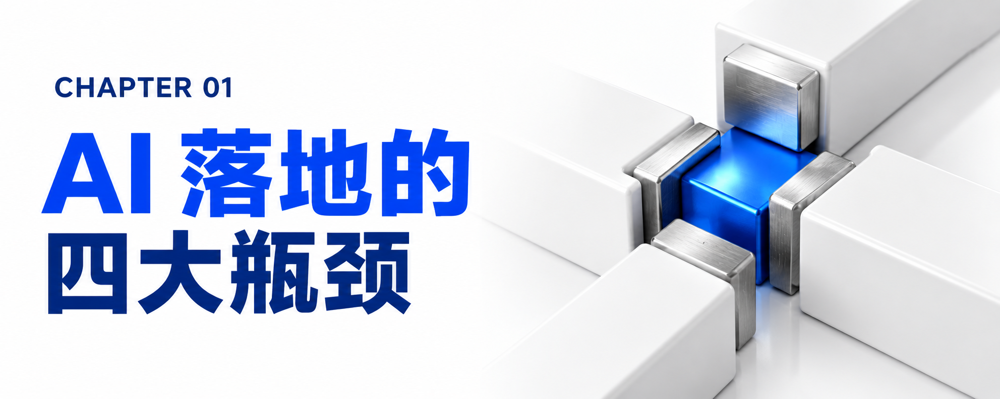
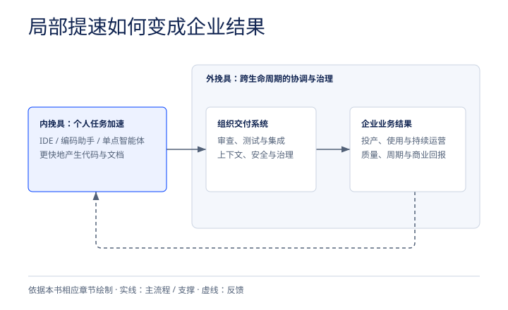

# 第一章：诞生的背景与 AI 落地的四大核心瓶颈

要理解 FDU 为什么会在这个时间节点诞生，我们必须先用客观的行业数据与工程遥测事实，还原当下全球企业级 AI 落地的真实处境。

## 1.1 狂热投入背后的冰冷数据：高涨的预算与低迷的规模化率

2026 年的企业级 AI 市场正处于一个极其矛盾的“转折点（Tipping Point）”：一方面是天文数字般的资金投入与无处不在的试点实验（Experimentation），另一方面却是难以逾越的规模化投产鸿沟。市场情绪已经发生了彻底的逆转——正如 IBM 咨询混合云与数据全球管理合伙人 Javier Olaizola 所言，客户的问题已经从最初的“用 AI 能做什么？（What can be done with AI?）”变成了冷酷务实的“请给我看你 AI 投资的财务红利（Show me the dividend of your AI investments）”。

然而，多项权威调研揭示了“宏大愿景”与“落地成果”之间的巨大断层：

- 规模化扩展率不足四分之一：根据 Gartner 在 2026 年 9 月基于 1,303 名大型企业（年营收至少 5,000 万美元）受访者发布的调研报告显示，尽管高达 85% 的职能部门领导者表示计划在 2026 年继续增加 AI 支出，但仅有 22% 的组织真正将 AI 规模化扩展到了多个业务部门，或者采纳了“AI 优先（AI-first）”的运营方式。
- 投资回报率（ROI）徘徊在低位：高额的投入并未自动转化为丰厚的回报，IBM 商业价值研究院（IBV）2026 年的一项最新研究指出，2026 年企业的平均 AI 投资回报率（ROI）仅为 17%。
- 战略认知与执行能力的严重撕裂：
- 72% 的高绩效企业 CEO 认同“未来的竞争优势取决于谁拥有最先进的生成式 AI”，但只有 38% 的高管认为自己的组织内部具备有效采纳生成式 AI 进行创新的专业能力。
- 在《2026 CEO 研究报告》中，79% 的高管预计 AI 到 2030 年将对公司营收做出重大贡献，但能够清晰描绘出“这笔新收益具体来自哪里”的高管全球仅占 24%（在日本高管中，这两个比例更是反差巨大的 82% 与 17%）。
- 高达 83% 的 CEO 坦言“AI 能否成功，与其说取决于技术本身，不如说取决于人能在多大程度上接受它”，但在日常工作中真正熟练运用 AI 的员工比例目前仅停留在 25%。
- 更致命的是组织壁垒：82% 的 C 级高管表示，企业内部的“职能孤岛（Functional Silos）”正在阻碍组织充分实现 AI 的价值。

## 1.2 核心病灶解剖：“AI 红利税（AI Dividend Tax）”与“加速鞭打效应”

*局部效率与企业交付系统的关系。依据本章原文绘制。*

为什么如今每一家严肃的企业都能轻易获取同样强大的基础大模型（如 GPT-5.6、Claude、Granite 等）和近乎可互换的编程工具链（如 GitHub Copilot、Claude Code、Cursor、OpenAI Codex、IBM Bob 等），基准测试分数天天创新高，但企业级财务成果却迟迟不兑现？

IBM 咨询高级合伙人 Debbie C Vavangas 提出了一个直击灵魂的概念——“AI 红利税（The AI Dividend Tax）”。

1. 什么是“AI 红利税”？
- 它描述了一种普遍存在的结构性失灵状态：AI 驱动的生产力提升确实在组织内部产生了，但在向企业级商业价值转化的过程中，这些收益被系统性地损耗和泄漏了。
- 在组织的边缘地带——在单个开发者的 IDE（集成开发环境）里、在业务分析师的文档生成中、在测试工程师的自动化脚本里，局部效率确实大大提高了：程序员写代码更快了，分析师写出的用户故事（User Stories）更丰富了，局部交付吞吐量上升了。
- 但是，当这些局部增益向企业全局传导时，信号却发生了严重衰减：产品的整体上市时间（Time-to-market）几乎没有缩短，产品差异化原地踏步，客户体验改善微乎其微。企业首席财务官（CFO）们正在发出灵魂拷问：“如果每个环节都变快了，为什么在投资组合层面上，没有任何东西变得更便宜、更快或者更有竞争力？为什么 AI 在兑现可衡量的价值之前，反而先推高了企业的成本基数？”
- 董事会批准巨额 AI 预算时期待的是“复利回报（Compounding Returns）”，最终收到的却是“碎片化的生产力（Fragmented Productivity）”——即在一个从未改变的旧系统内部，做着局部的孤立优化。这种因组织架构和交付体系不匹配而吃掉的效率红利，就是企业被迫缴纳的“AI 红利税”。
2. 实证震撼：“加速鞭打效应（Acceleration Whiplash）”
- 局部提速不仅未必带来全局收益，甚至可能引发下游系统的崩溃。2026 年发布的《Faros AI 工程报告》对 4,000 个研发团队、超过 22,000 名开发者长达两年的工程遥测数据进行了深度剖析，得出了一个令业界警醒的结论：
  - 尽管 AI 工具大幅提升了开发者个人的编码产出，但下游工程质量与交付结果却全面恶化；
  - 拉取请求（Pull Request，简称 PR）的代码体积显著膨胀；
  - 代码审查（Code Review）的中位等待时间不降反升；
  - 更多的 PR 在未经充分审查的情况下被直接强行合并；
  - 人均产生的软件缺陷（Bugs per developer）数量上升；
  - 每个 PR 引发的生产环境事故（Production incidents per PR）频率显著增加。
- Faros 将这种现象命名为“加速鞭打效应（Acceleration Whiplash）”——即当个体的生产速度超越了组织系统（审查、测试、集成、治理、部署）能够消化和吸收它的极限时，局部的加速反而会在下游造成严重的拥堵与质量灾难。
3. 根源剖析：内挽具（Inner Harnesses）与外挽具（Outer Harnesses）的严重失衡
- 为什么会出现“加速鞭打”？因为绝大多数企业把钱都砸在了“内挽具（Inner Harnesses）”上——即通过编程助手或单点智能体优化个人在单一任务或开发会话中的执行效率。
- 而真正决定个人生产力能否转化为企业绩效的，是“外挽具（Outer Harnesses）”——即跨整个交付生命周期协调工作流，将 AI 与企业业务上下文、安全治理、生命周期管理和组织知识连接起来的编排层。
- 只买“内挽具”而不建“外挽具”，就相当于“只给汽车换了一台马力狂暴的赛车发动机，却完全保留了老旧的变速箱、刹车和底盘”，一脚油门下去，结果必然是原地打滑甚至车毁人亡。

## 1.3 阻碍 AI 落地的四大系统性瓶颈

综合 IBM 在全球数千家企业的实战诊断，当前阻碍 AI 从实验室试点（Pilot）走向大规模生产（Production）的瓶颈绝不是“模型不够聪明”，而是以下四个相互交织的系统性障碍：

**企业级 AI 规模化落地的四大系统性瓶颈**

| 项目 | 说明 |
| --- | --- |
| 1. 数据与上下文瓶颈  | 数据碎片化、困在非结构化孤岛中，缺乏机器可读的业务上下文 |  |
| 2. 遗留系统与流程债  | 几十年积累的手工交接与旧流程，在低效流程上直接加 AI 只是把低效自动化 |  |
| 3. 安全治理与合规墙  | 传统事后合规审查要么拖慢交付，要么被绕过；缺乏运行时的受控自治边界 |  |
| 4. 旧人力时代运营模式| 瀑布式接力造成严重组织延迟；按工时/FTE 计费的商业模式惩罚提效者 |  |

- 第一，数据碎片化与业务上下文缺失（Data & Context Bottleneck）：企业并不缺数据，但数据处于休眠、割裂或不可信的状态。大量核心知识被困在 SharePoint 站点、内容管理系统（CMS）、供应商报告、工单日志以及业务专家的脑子里，呈现为非结构化、多模态的碎片状态，智能体在决策瞬间根本无法提取、标准化并信任这些数据。
- 第二，遗留系统与流程技术债（Legacy Systems & Process Debt）：在金融、电信、制造、公用事业等成熟企业中，核心业务运行在积累了数十年的遗留系统（如复杂定制的 ERP、大型机等）之上。更可怕的是“流程债”——多年的复杂运营留下了无数手工交接（Manual Handoffs）、审批节点、例外处理路径和权宜之计。这些流程是为“人”设计的，而不是为“自主智能体”设计的；如果不重新设计流程就直接塞入一个 AI 智能体，结果只能是“将低效自动化（Automate the inefficiency）”，而不是消除低效。
- 第三，安全、风险治理与主权合规的高墙（Governance, Security & Sovereignty）：2026 年《数据泄露成本报告》显示，由深度伪造（Deepfake）和 AI 恶意软件主导的 AI 驱动型网络攻击激增了 56%。在真实生产环境中，一段代码即便功能运行正常，只要违反了银行的安全规则或调用了未经授权的数据，它就是完全不可用的废品。然而，多数企业的 AI 治理还停留在“事后合规审查”阶段，与日常执行脱节——团队要么为了应付合规审查而陷入停滞，要么为了赶进度直接绕过管控，这两种情况都无法规模化。
- 第四，为“人力时代”设计的运营与商业模式（Labor-Era Operating & Commercial Models）：过去几十年，软件与咨询交付被拆分为需求分析、架构设计、开发、测试、发布、运维等漫长的职能接力棒。每一个交接环节都有审查、会议和等待，这种被企业误以为是“管控（Control）”的“结构性摩擦（Structural Friction）”，造成了巨大的组织延迟（Organizational Latency）。同时，按“人头（FTE）”和“工时（Billable Hours）”计费的商业体系，从根子上与 AI 的提效逻辑背道而驰。
