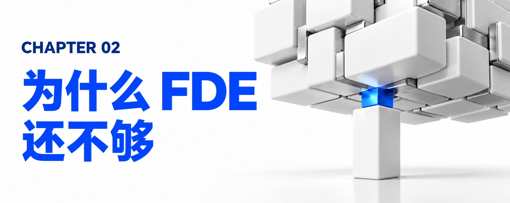

# 第二章：为什么 FDE 还不够？——单兵模式的五大结构性死穴

面对上述四大系统性瓶颈，许多科技厂商和企业的第一反应是：“既然战略咨询顾问只会写 PPT 不会写代码，而普通程序员只会在后台写代码不懂业务，那我们派驻全能的 FDE（前线部署工程师） 去客户现场不就行了吗？”

IBM 明确指出：FDE 是拼图的一部分，但绝不是整张拼图。将宝全部押在 FDE 这一单一角色上，在真实的企业级深水区里会立刻撞上五大结构性死穴：

## 2.1 死穴一：系统性工程复杂度远超任何个体的认知与能力极限

在互联网原生或小型初创企业中，一两个天才 FDE 或许能手搓出一套可用的 AI 应用；但在大型企业的核心运营环境里，没有任何一个自然人能够独自摆平以下所有问题：

- 梳理并重构跨越数千份标准作业程序（SOP）的行业深水区业务流程；
- 打通跨 AWS、Azure、Google Cloud、SAP、Oracle、Salesforce 以及本地大型机（Mainframe）的多厂商异构技术栈架构；
- 清洗并治理散落在数十个孤立数据库与文档库中的脏数据；
- 满足金融、医疗、能源、政务等强监管行业苛刻的安全审计与数据主权要求；
- 同时还要把从“概念构想”到“生产环境投产”的周期，从传统的“数月乃至数年”暴力压缩到“几天或几周”。

正如 IBM 咨询总裁 Mohamad Ali 所强调的：“真正的问题不在于人才，而在于系统性。一个单独的工程师远不如一个完整的作战单元（Unit）有用。”

## 2.2 死穴二：“上线即撤离”导致的投产与持续运营断层（The Post-Launch Gap）

传统软件交付往往把“上线（Go-live）”视为项目的终点，但对于智能体 AI（Agentic AI）而言，上线恰恰只是万里长征的第一步。

- 智能体系统不是静态的规则代码，它像一个活的有机体，在生产环境中会遭遇数据管道断裂、模型漂移（Model Drift）、Token 成本失控、新型提示词注入攻击以及不断变化的业务边缘案例（Edge Cases）。它需要持续的调优、评估、治理以及与实时业务工作流的深度磨合。
- 当企业的交付完全依赖 FDE 个体角色时，一旦系统初步启动运行（Up and running），这些高薪且稀缺的 FDE 往往会面临巨大的资源调配压力，被迅速抽调赶往下一个客户或下一个救火现场。
- 其结果就是：在“项目上线（Implementation）”与“持续高性能运行（Sustained Performance）”之间出现了一道致命的断层，系统上线几个月后便因缺乏持续治理与迭代而退化甚至废弃。

## 2.3 死穴三：缺乏平台化复利底座，陷入“手工作坊式”的冷启动循环

如果只有前线工程师而没有统一的智能体交付平台与执行挽具（Harness），每一次客户交付都会退化为高成本的“手工作坊”：

- 每进驻一家新客户，FDE 都不得不从零开始（Cold Start）重新界定范围、重新配置安全策略、重新编写胶水代码、重新做测试验证。
- Mohamad Ali 在接受 CRN 专访时犀利地嘲讽了行业内某些竞争对手的做法：将近三年前生成式 AI 刚兴起时，所有竞争对手都在疯狂采购成千上万个 Microsoft Copilot 或 OpenAI 许可证，直接发给手下的 10 万名员工说：“给你们账号，去变得更有生产力吧！”结果证明，这种做法彻底失败了（It just didn't work）。
- 没有可复用的行业资产库、没有固化的代码化方法论（Method-as-Code）、没有底层的治理挽具，单靠工程师个人带着通用的聊天大模型去前线拼刺刀，不仅交付速度慢、质量极其不稳定，更无法将上一个项目踩过的坑转化为下一个项目的复利资产。

## 2.4 死穴四：缺乏商业结果问责机制（The Accountability Gap）

企业高管层今天要买的不是“几个聪明的工程师驻场写代码”，而是确凿无疑的商业结果（Business Outcomes）——比如财务关账周期缩短多少天、获客成本降低百分之几、合规敞口如何彻底关闭、每笔内部转岗成本下降多少。

- 一名 FDE 的核心职责是技术实现与智能体编排，他既没有组织授权、也没有足够的行业高管资历去推动客户内部的跨部门流程变革与利益重组，更不可能在客户的季度业务评审会（QBR）上为客户的损益表（P&L）指标背锅负责。
- 没有专门的商业成果负责人坐镇，前线团队极易滑向“只管按需求把活干完，至于能不能产生商业结果全凭运气”的传统外包老路。

## 2.5 死穴五：客户内部能力无法沉淀，造成永久性“外包依赖症”

单兵驻场开发往往聚焦于自己把代码快速写出来，而在项目结束时通过几场走过场式的“知识转移宣讲会（Knowledge-transfer presentations）”或静态文档把系统甩给客户。客户的业务与 IT 团队由于没有在架构设计、上下文梳理和智能体编排的全过程中与跨学科专家深度并肩作战，在外部 FDE 撤离后根本不知道如何自主运维、扩展和演化这套系统。
