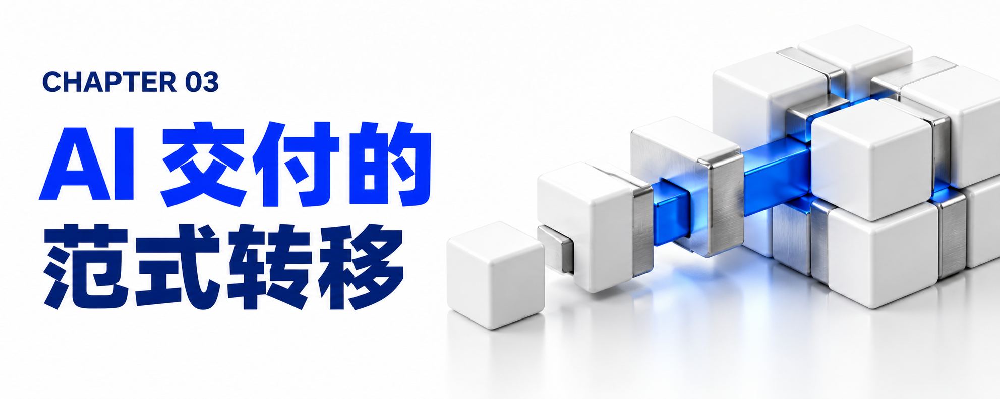

# 第三章：AI 交付正在发生什么？——重塑游戏规则的四大范式转移

在深入拆解 FDU 的内部构造之前，我们必须看清当前全球软件工程与技术咨询行业正在发生的四场底层地震。正是这四大范式转移，共同催生了 FDU。

## 3.1 范式转移一：规模化因子的质变——从“堆人力”到“编排智能体”

在过去整整三十年的时间里，无论是 IT 服务、管理咨询还是企业内部研发，“人力（Labor）”都是唯一的规模化扩展因子（Scaling Factor）。

- 旧等式（人力时代）：产出与人类的工时容量呈严格的线性关系——想要更多产出，就必须投入更多的人头（Add more people, get more output）。市场上所有的商业计价原语——工时与材料合同（Time and Materials, T&M）、T 恤尺码工作量估算（T-shirt sizing）、项目组人月（Pod month）、按全职等效员工（FTE）固定计价——全部都是围绕“人力线性扩展”这一公理校准的。
- 新等式（AI 时代）：AI 成为了新的规模化因子。产出不再与人类员工的数量成正比，而是取决于一个组织的运营模式——团队如何编排智能体、如何执行严格的评估纪律（Evaluation Discipline）、如何运行可复现的方法论，以及如何将原始模型能力转化为可衡量的业务成果。
- 残酷的分水岭：围绕新规模化因子重建交付单元的团队，将全额捕获“AI 红利（AI Dividend）”；而继续固守旧人力模式的团队，则会因为 AI 压缩了工时导致计费小时数（Billed Hours）萎缩，买卖双方都无法捕获真正的价值，最终彻底输掉牌局。

## 3.2 范式转移二：软件与 AI 工程形态的“四级跳”

IBM 咨询混合云服务全球管理合伙人 Varun Bijlani 指出，整个行业的工程交付方式已经并正在经历四个阶段的跃迁：

1. 第一阶段：辅助开发（Assisted Development）——以代码自动补全、单点提示词工程（Prompt Engineering）和聊天问答助手为代表，仅提升程序员个人的敲键盘速度。
2. 第二阶段：资产驱动交付（Asset-driven Delivery）——引入可复用的代码组件、模板和行业加速器，减少重复开发。
3. 第三阶段：智能体能力（Agentic Capabilities）——由具备自主推理（Reason）、规划（Plan）和执行（Execute）能力的智能体系统承担多步骤复杂任务。
4. 第四阶段（当前正在爆发的新浪潮）：规范驱动开发与上下文工程（Spec-driven Development & Context Engineering）——这一范式贯穿整个软件开发生命周期（SDLC）。智能体不再仅仅帮人类写代码，而是参与设计、测试、治理和运维整个系统；企业上下文数据与机器可读规范（Machine-readable Specifications）取代了传统的静态文档，成为驱动智能体军团自动运转的“唯一事实来源（Source of Truth）”。

## 3.3 范式转移三：告别“舒适中间层”，迈向超高“人才密度”的微型团队

传统的研发与交付组织是为了“可管理性（Manageability）”而非“速度”设计的。为了协调庞大的专职人员，企业建立起了厚重的“舒适中间层（Comfortable Middle Layer）”——一个简单功能的上线，要依次流经业务分析师、架构师、开发人员、测试人员、发布经理和运维团队，每一次跨部门移交都伴随着大量的对齐会议、Jira 工单催促和审批等待。

如今，由于 AI 接管了代码脚手架生成、文档编写、测试用例生成、缺陷调试和部署编排等常规执行工作，工程交付的核心约束条件已经从“开发产能不足”变成了“能否快速做出正确的技术与业务决策”。这引发了团队规模与人才结构的剧变：

- Gartner 的重磅预测：Gartner 在 2026 年 6 月发布的报告《用 FDE 或 AI 赋能人才的微型团队提升技术服务》中明确预测：“到 2029 年，80% 的企业将主动优先考虑‘人才密度（Talent Density）’而非‘人才规模（Talent Mass）’，而在 2025 年这一比例仅为 5%。” 同时，“到 2029 年，80% 的服务提供商将放弃传统的生产力指标，转而聚焦于创造力、创新与敏捷性。”
- 团队规模的极致坍缩与杠杆放大：
- 在 IBM 的 FDU 模式中，一个 6 人的精英作战单元（Pod），配合中间层的智能体数字员工，可以完成以往 30 人团队的工作量，且经济效益大幅优化。
- 在日常典型配置中，往往只需 3 到 4 名人类专家，协同 10 到 20 个 AI 智能体 并肩作战。
- 在极端的大规模现代化工程中，这种压缩更加惊人：Javier Olaizola 披露了印度一家大型银行正在进行的数据现代化项目——该银行需要将成百上千个遗留数据处理作业迁移到新技术平台，按传统模式需要大约 300 人苦干 12 到 15 个月；而采用 FDU 模式后，由于智能体吸收了绝大部分重复性的代码转换与测试工作，IBM 仅用原有团队极小的一部分兵力（a fraction of that team），在不到 9 个月的时间内就完成了交付。
- 价值向“判断层（The Judgment Layer）”迁移：当智能体承担了生产工作，初级人员纯粹靠“堆工时、刷吞吐量（Junior Throughput）”的价值归零，人类的核心价值全面上移至“判断层”——正如新闻业的演变一样，AI 可以瞬间生成海量文章，但依然需要资深记者和编辑去判断内容是否准确、是否合规、是否提供了正确的视角。

## 3.4 范式转移四：从“离岸人力套利”走向“技术套利（Technology Arbitrage）”

这场变革正在彻底改写全球 IT 服务与咨询行业的竞争版图。Mohamad Ali 一针见血地指出：

- 十五年前的旧游戏是“人力套利（Labor Arbitrage）”：各大咨询与外包巨头把成千上万名工程师放到印度、东欧或东南亚等低成本地区，靠地域薪资差价来降低交付成本。
- 今天的新游戏是“技术套利（Technology Arbitrage）”：通过构建“人类专家 + 数字员工（Human + Digital Labor）”的工厂化流水线，用技术杠杆替代低端人力堆砌。
- 颠覆性的市场奇观：在近期欧洲一家制药巨头的项目竞标中，素来以“高品质、高价格”著称的 IBM 咨询，正面迎战多家主打廉价人力的传统离岸外包商（Low-cost offshore providers）。令人意想不到的是，凭借“人类 + 数字员工”的 FDU 组合方案，IBM 竟然成为了全场报价最低的供应商（Low-cost provider），同时兼具最高质量的工程能力。不仅如此，因为团队规模变小、身段极其敏捷，以前只服务超大型巨头的顶级咨询团队，现在得以强势切入过去无法触达的中型企业市场（Midmarket）。
