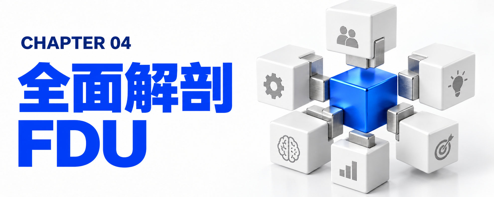
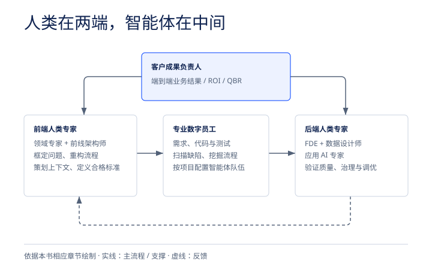

# 第四章：全面解剖 FDU——它到底是什么？为什么必须是 FDU？




既然 FDE 单兵模式走不通，而行业又迎来了上述四大范式转移，那么 IBM 给出的终极答案——FDU（Forward Deployed Units，前线部署单元）——究竟长什么样？


## 4.1 FDU 的核心定义与结构拓扑：“人类在两端，智能体在中间”



*FDU 团队结构与结果问责。依据本章原文绘制。*


FDU 不是一个人（Person），而是一个高度结构化的常设作战单元（Pod）。它是连接底层 AI 平台与企业级业务转型的桥梁，代表着企业转型从传统的“咨询顾问主导（Advisory-led transformation）”向“工程主导型转型（Engineering-led transformation）”的彻底跃迁。

FDU 最核心的架构设计哲学，可以用一句话精准概括：“人类专家位于两端，专业的 AI 智能体数字员工队伍位于中间（Humans at the edges, agents in the middle）。”

<details class="source-diagram">
<summary>原稿示意图（文字版）</summary>

```text
====================================================================================
                    FDU（前线部署单元）核心工作流拓扑架构图
====================================================================================

                 [ 客户成果负责人 (Client Outcome Lead) ]
        （立于工作流之上：端到端对商业结果与 ROI 负责，直接出席客户 QBR）
                                    │
       ┌────────────────────────────┴────────────────────────────┐
       ▼                                                         ▼
【左端：前端人类专家】                                    【右端：后端人类专家】
  (定义与上下文策划层)                                      (判断、验证与治理层)
┌──────────────────────┐                                ┌──────────────────────┐
│ • 业务领域专家 (BDS) │                                │ • 前线部署工程师(FDE)│
│ • 前线部署架构师(FDA)│                                │ • 数据设计师         │
│                      │      【中间层：数字员工队伍】     │ • 应用 AI 专家       │
│ 核心职责：           │      (10-30+ 专业 AI 智能体)    │                      │
│ 1. 框定业务问题与意图│     ┌────────────────────┐     │ 核心职责：           │
│ 2. 重构端到端业务流程│ ──► │ • 编写需求与拆解故事│ ──► │ 1. 严把“判断层”大关  │
│ 3. 提炼并策划上下文  │     │ • 自动生成与转换代码│     │ 2. 验证准确性与合规性│
│ 4. 编写机器可读 Spec │     │ • 生成测试与扫描缺陷│     │ 3. 调优输入上下文指令│
│ 5. 定义“好结果”的标准│     │ • 挖掘旧流程与写文档│     │ 4. 确保生产级安全可控│
└──────────────────────┘     └────────────────────┘     └──────────────────────┘
       ▲                                                         │
       └───────────────── 持续执行与复利反馈闭环 ────────────────┘
====================================================================================
```

</details>


让我们仔细拆解这个拓扑结构是如何彻底颠覆传统工作流的：

- 绝不是简单的“人在环路（Human-in-the-loop）”外挂补丁：在 FDU 中，人类与智能体从设计之初就是融为一体的（By design）。
- 左端（工作流入口）：由业务领域专家和前线部署架构师把守。他们深入客户现场，负责界定工作边界（Frame the work）、策划并清洗业务与技术上下文（Curate the context），并明确定义“什么样的交付结果才算合格（Define what good looks like）”。
- 中间层（工作流腹地）：真正繁重、重复、高吞吐量的生产性工作（The work itself），全部交由 10 到 20 个（甚至按项目包配置的 20 到 30 个）专业 AI 智能体组成的“数字员工队伍（Digital Workforce）”去执行。它们在受控的上下文中，按照代码化的标准方法论（Codified Methods），高速执行需求编写、代码生成、测试用例构建、软件缺陷扫描、遗留系统模式识别和文档更新。
- 右端（工作流出口）：由前线部署工程师、数据设计师和应用 AI 专家把守。他们构成关键的“判断层（Judgment Layer）”，负责审查并确保智能体生产出的每一行代码、每一个配置都是正确的、可治理的、符合银行或监管安全标准的，并且具备直接上线生产环境的品质。
- 顶层（结果问责层）：客户成果负责人（Client Outcome Lead）坐镇于整个工作流之上，不对“干了多少活”负责，而是对“这套工作流最终产生的商业结果”端到端负责。


## 4.2 深入解析 FDU 内部的“六大黄金角色”


为了彻底避开旧交付模式的所有陷阱，IBM 在 FDU 内部精密设计了 6 类互补的前线部署角色。这六个角色各司其职，缺一不可：

| 序号 | 角色名称 | 角色定位与资深程度 | 核心职责与日常工作 | 解决的传统交付死穴 |
| --- | --- | --- | --- | --- |
| 1 | 客户成果负责人<br>(Client Outcome Lead) | 前甲方高管或咨询资深合伙人（非应届生） | 领导小队日常运转；直接对关账周期压缩、获客成本下降、吞吐量提升、监管风险消除等业务指标负责；在客户季度业务评审（QBR）上直接向高管述职。 | 消除“问责断层（Accountability Gap）”：将按结果付费从一纸合同条款变成一个活生生的责任人。 |
| 2 | 业务领域专家<br>(Business Domain Specialist) | 深耕特定行业与职能流程的资深专家 | 带来真正的垂直行业与职能专长（而非泛泛的通用流程咨询），与客户的流程所有者（Process Owners）深度博弈、挑战现状并重新设定业务目标与流程设计。 | 解决“流程重塑挑战（Reimagined Process Challenge）”：防止把旧的低效流程原封不动地搬上 AI。 |
| 3 | 前线部署架构师<br>(Forward-Deployed Architect, FDA) | 资深到首席级（Senior-to-Principal）技术领袖 | 绝非画完架构图就消失的传统企业架构师；驻场客户环境，具备跨多厂商技术栈的深厚工程权威；负责集成层，连接 AI 系统、终端系统与记录系统（Systems of Record），用经过验证的可复用资产设计方案。 | 弥合“战略到执行的鸿沟（Strategy-to-Execution Gap）”：杜绝“PPT 上好看但根本造不出来”的空中楼阁架构。 |
| 4 | 前线部署工程师<br>(Forward-Deployed Engineer, FDE) | 资深实战派全栈/AI 工程师（非初级外包工） | 在 FDA 架构指引下，将 AI 资产、智能体与应用编排为内聚的业务方案；采用“用智能体开发智能体”的方法极速构建系统；在复杂企业环境中自主做出对齐业务价值的技术决策。 | 解决“实施速度瓶颈（Implementation Velocity Problem）”：大幅压缩从构想到上线投产的时间周期。 |
| 5 | 数据设计师<br>(Data Designer) | 企业级数据架构与治理专家 | 专注于为智能体系统准备、清洗、结构化和治理企业级数据，打通实时数据流，确保智能体在推理和行动时能获取准确、及时、合规的数据上下文。 | 解决“垃圾进、垃圾出”的数据就绪度瓶颈：让沉睡的数据变成可执行的运营燃料。 |
| 6 | 应用 AI 专家<br>(Applied AI Specialist) | 智能体工程与底层调优专家 | 负责具体的智能体执行细节，包括高级提示词工程、多智能体协同编排（Multi-agent Orchestration）、运行故障诊断以及遗留代码库的自动化改造。 | 实现“重治理胜过重生成（Governance over Generation）”：设定约束条件，确保智能体产出正确代码。 |


## 4.3 常设作战单元（Standing Operational Unit）与行业专属配置


除了内部角色设计，FDU 在组织形态上还有两个极其重要的创新点：

1. Pod 身份的持久性（Persistence of Pod Identity）——打破“项目散伙制”
- 在传统咨询或 IT 外包中，项目组是一个临时拼凑的结构（Project Construct），一旦项目交付结束，团队就地解散，人员各自流散到其他项目，项目中好不容易积累起来的行业默契与隐性知识瞬间归零，下一个项目又要重新磨合。
- 而在 FDU 模式中，Pod（作战单元）是常设的交付运营单位（Standing operational unit of delivery）。虽然 Pod 内部的具体人员配置可以根据不同项目的规模需求灵活伸缩（小单元约 3 人，标准单元 6 人，大单元约 8 到 10 人），但这个 Pod 的核心身份标识与资产记忆库是跨项目持久存续的。
- 这种持久性使得业务知识层、智能体配置与工程经验能够留在同一批人的手中，在连续多个客户项目中像滚雪球一样不断复利累积、越用越锋利（Methods sharpen with every engagement）。
2. 拒绝“万金油”：按垂直行业与职能结果预配置的专属 FDU
- FDU 从来不是通用的“万金油”外包小队，而是针对特定行业和职能领域的业务成果进行高度定制化预配置的。例如 IBM 目前重点部署的四类主力 FDU：
  - 财务转型 FDU（Finance Transformation FDUs）：专门聚焦于财务预测、财务关账加速、日记账分录自动化以及财务数据编排。
  - 客户转型 FDU（Customer Transformation FDUs）：专门聚焦于 Salesforce、CRM 客户旅程、Einstein、MuleSoft、Slack 以及客户体验/员工体验智能体的构建。
  - IT 运维 FDU（IT Operations FDUs）：专门聚焦于智能运维（AIOps）、运维手册（Runbooks）自动化、系统可观测性、故障自主修复（Autonomous Remediation）以及站点可靠性工程（SRE）工作流。
  - 核心银行现代化 FDU（Core Banking Modernization FDUs）：专门聚焦于大型机（Mainframe）集成、核心数据激活、金融合规、支付、存贷款系统以及 API 与事件驱动架构的现代化改造。
