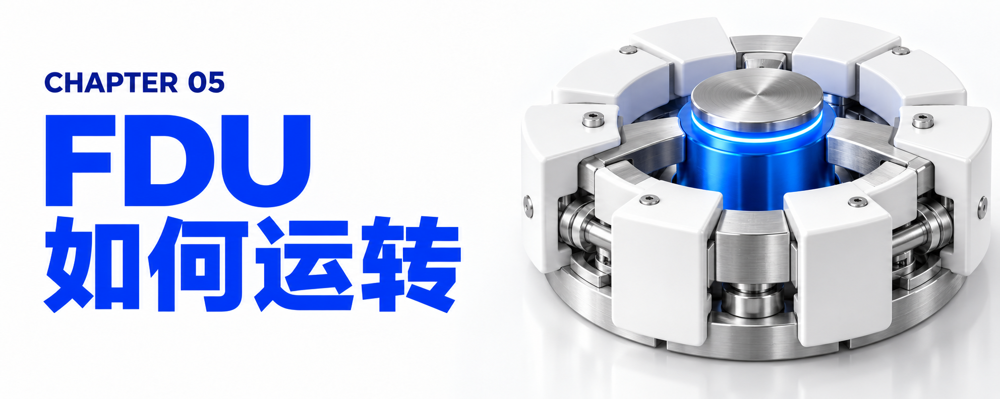
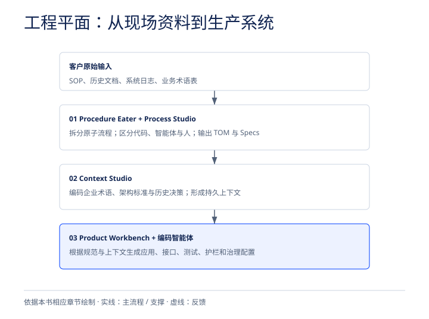
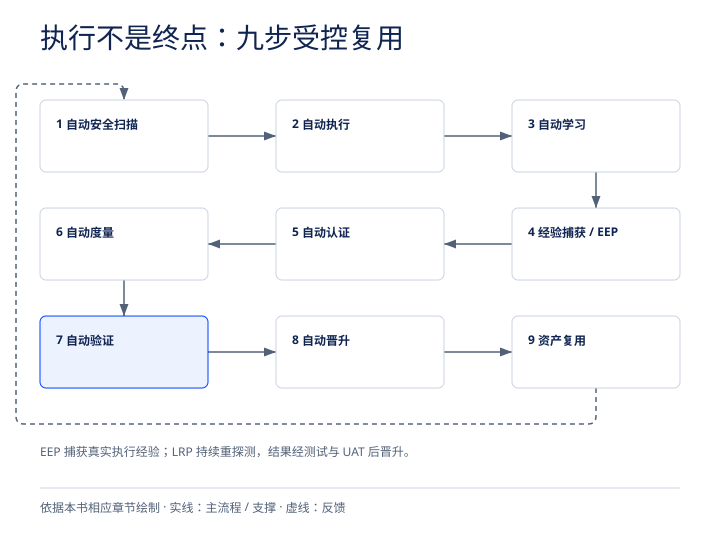
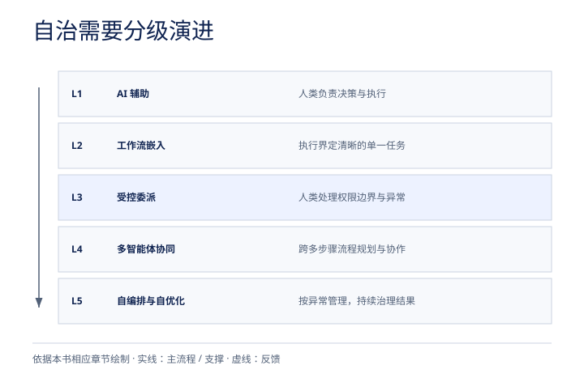

# 第五章：保姆级运行机制拆解——FDU 究竟是如何运转的？




“派驻一支精干的小团队去客户现场”听起来很美好，但如果仅仅把人派过去，那依然只是换了个名字的驻场外包。FDU 之所以能爆发出“6 人顶 30 人”的恐怖战斗力，是因为在这些人类专家身后，连接着一套庞大的工业级 AI 交付母舰、工程平面、激进应用开发（RAD）规范体系以及声明式执行挽具（Harness）。

下面，我们将从底层的平台底座、工程三剑客、代码规范文件、执行挽具闭环、控制平面与数字员工考证，一直拆解到商业计费与薪酬激励，为您完整还原 FDU 的内部运转全貌。


## 5.1 动力母舰：IBM Consulting Advantage (ICA) 与 6,000 名数字员工的工业化装配


所有 FDU 小队都运行在一个统一的 AI 驱动型交付平台——IBM Consulting Advantage（简称 ICA） 之上。Mohamad Ali 将 ICA 形象地称为一个“超级挽具（Uber Harness）”。

让我们通过一组硬核的内部运营数据，看看这艘母舰在后台是如何运转的：

- 支撑 15 万顾问、月吞吐 5,000 亿 Tokens 的庞大规模：
- ICA 平台目前武装了全球近 150,000 到 160,000 名 IBM 咨询顾问，使顾问的日常生产力提升了高达 50%。
- 该平台每个月消耗约 5,000 亿（Half a trillion）个 Tokens，在全球每年执行的 2,000 多个大型项目中，目前已有约 600 个大型项目 正在这座“人机协同工厂”中实时制造出来，累计支撑了超过 100 亿美元 的生成式 AI 咨询业务订单（Book of business）。
- 智能模型路由器（Model Router）：将成本压到每百万 Token 2.58 美元：
- ICA 底层完全开放，兼容 IBM watsonx（Granite 模型）、OpenAI（如 GPT-5.6、Codex、ChatGPT Work）、Anthropic（Claude / Claude Code）、Google Gemini、Meta、Mistral 等各类闭源与开源模型。
- 为了防止算力成本失控，ICA 内置了一个智能模型路由器（Model Router），能够根据任务复杂度自动匹配最具性价比的模型——这让 IBM 能够精确算出上个月全平台的平均调用成本仅为惊人的 每百万 Tokens 2.58 美元。
- 从 50,000 到 6,000：数字员工的严苛淘汰与“155 个技能包（Packs）”装配：
- 在 ICA 中，任何调用大语言模型（LLM）处理非确定性任务的模块都被抽象为一名“数字员工（Digital Worker）”。
- 当 IBM 最初发动全员构建专用 AI 工具时（例如在 17.8 万名员工参与的 watsonx 挑战赛中），平台上一度涌现出多达 50,000 个 数字员工，但太多太杂反而不好用。
- 于是，Mohamad Ali 专门从软件部门挖来了一支专业的产品管理（PM）与质量保证（QA）团队，对这 5 万个数字员工进行了严酷的分诊、测试与淘汰，最终去芜存菁，提炼出 6,000 个高质量、达到生产级标准的数字员工 正式编入生产序列。
- 这 6,000 名数字员工被进一步按行业与技术场景打包封装成 155 个标准技能包（Packs）。举个直观的例子：如果一个 FDU 要为某家银行开发一套基于 Adobe 的前端系统，小队只需从 ICA 调取对应的技能包——里面直接配好了 20 到 30 名专用数字员工，然后与 10 名人类专家 拉进同一个数字化作战聊天室（Chatroom），你就能实时看到人机团队在里面一起拆解用户故事、编写代码、执行测试，直到项目完工。
- 核心 IP 的“用完即焚”护城河机制：
- 许多外部 AI 工具要求用户在它们自己的环境里原生构建技能（Skills），但这会导致咨询公司的核心知识外泄或被绑定。
- IBM 采取了独特的集中式保护机制：所有的“技能（Skills）”和流程资产都集中保存在 ICA 中央库里；当 FDU 需要在客户的某个外部 AI 工具中使用时，技能会被动态下载到该工具中执行，任务完成后即刻从外部工具中消失。这种中央 IP 保护池随着每个项目的回馈越滚越大，构成了竞争对手难以跨越的护城河。
- 零特权安全接入与向客户移交（IBM Enterprise Advantage）：
- 在安全方面，ICA 中的智能体完全在客户现有的安全边界（Security Perimeter）和访问控制权限内工作，不享有任何特殊特权，直接插入客户现有的数据治理体系，因此客户的首席信息安全官（CISO）根本不需要额外审批一套新的安全控制平面（同时 ICA 还获得了美国联邦政府严苛的 FedRAMP 授权，可在 AWS GovCloud 等高密级环境运行）。
- 更进一步，如果客户希望在 FDU 撤离后继续在内部大规模复用这套平台，IBM 推出了 IBM Enterprise Advantage 资产型咨询服务——直接将 ICA 的能力贴上客户自己的品牌标识，作为客户自有的企业级内部 AI 平台留存下来，并把相关数字员工和资产授权（License）给客户持续运营。


## 5.2 工程平面（Engineering Plane）三剑客：从“周末吞噬规程”到自动生成智能体



*工程平面输入与产出。依据本章原文绘制。*


当一支 FDU 小队进驻客户现场，面对客户那如山般堆积、连客户自己都说不清的旧业务流程时，他们是如何动手改造的？

在传统咨询模式里，顾问们会拿着五颜六色的便利贴（Stickies）贴满会议室白板，花上几个月甚至一年多的时间去访谈、梳理现状流程（As-Is）并绘制理想流程（To-Be）。而在 FDU 模式中，这一过程被集成在 ICA 内部的“工程平面（Engineering Plane）”三大核心工作室（Studios）彻底自动化了：

<details class="source-diagram">
<summary>原稿示意图（文字版）</summary>

```text
+-----------------------------------------------------------------------------------+
|                        FDU 工程平面（Engineering Plane）全自动流水线               |
+-----------------------------------------------------------------------------------+
|                                                                                   |
|  [客户原始输入]：成百上千份标准作业程序(SOP)、历史文档、系统日志、业务术语表        |
|         │                                                                         |
|         ▼                                                                         |
|  【第 1 站：Procedure Eater (规程吞噬者) & Process Studio (流程工作室)】            |
|   • 周末自动运行，吞噬数千份 SOP，挖掘痛点、技术栈透镜与缺失环节                    |
|   • 将复杂业务分解为可独立验证的“原子级步骤 (Atomic Processes)”                     |
|   • 自动分流：哪些用“确定性代码”、哪些交“AI 智能体”、哪些需“人在环路”               |
|   • 自动输出：目标运营模式(TOM)、FTE 缩减测算 PPT、全套智能体与 MCP 连接器规范(Specs)|
|         │                                                                         |
|         ▼                                                                         |
|  【第 2 站：Context Studio (上下文工作室)】                                        |
|   • 将企业专有术语、业务关系、架构标准与历史决策转化为“机器可读的知识底座”          |
|   • 保障数据主权，为智能体注入真正的企业级持久记忆                                  |
|         │                                                                         |
|         ▼                                                                         |
|  【第 3 站：Product Workbench (产品工作台) + 编码智能体 (Codex / Claude / Bob)】    |
|   • 将 Process Studio 生成的 Specs 与 Context Studio 的上下文直接输入编码器         |
|   • 自动生成带测试套件、安全护栏与治理策略的生产级 AI 智能体及完整应用程序          |
+-----------------------------------------------------------------------------------+
```

</details>


让我们结合 IBM 咨询总裁 Mohamad Ali 与产品团队披露的实战细节，一步步拆解这条流水线是如何重构企业核心流程（以经典的“应付账款 Accounts Payable”流程重塑为例）的：

1. 前置准备：人类+数字员工的黄金行业蓝图（Human + Digital Blueprints）
- 要重塑应付账款流程，FDU 首先需要三样东西：第一是搞清楚客户现有的流程长什么样（As-Is），如果客户连文档都不全，FDU 甚至可以协同生态渠道伙伴先行探查摸底；第二是明确一个“理想状态下的应付账款流程”应该长什么样——IBM 将过去 30 年在银行业、电信业及企业核心职能部门积累的流程经验，全部代码化（Codified）封装进了系统，形成了标准化的“人机协同重塑蓝图”。
2. 第一站：Procedure Eater（规程吞噬者）与 Process Studio（流程工作室）
- 客户将现有的标准作业程序（SOP）和流程文档交给 FDU 后，小队不需要人工逐页阅读，而是直接启动工作流分析工具 Procedure Eater（规程吞噬者）。
- 周末无人值守运行：你可以看着它在周末自动运转，吞噬并解析上千份 SOP，自动识别出底层的技术栈视角、业务痛点，甚至精准指出客户现有流程中“缺失了哪些关键环节”。
- 原子级拆解与人机分流：接着，系统会将应付账款流程拆解为可独立验证的“原子级流程（Atomic Processes）”与子流程，并严格区分哪些环节遵循固定规则、应当使用确定性代码（Deterministic Code）处理，哪些环节需要解释与弹性判断、应当委派给 AI 智能体，以及人类在环路中（Human-in-the-loop）应当在哪个节点介入。
- 自动生成高管汇报 PPT 与智能体规范（Specs）：分析完成后，系统会直接给出定量诊断结论——例如：“您共有 18 个原子级流程，如果采用‘人类+数字员工’重塑，其中 9 个可以做得极好，1 个暂不适合，最终可实现多少比例的 FTE（全职等效员工）缩减。” 随后，它会自动构建出一整套包含人员、流程、技术与治理结构的目标运营模式（Target Operating Model, TOM），并直接生成一份可直接呈交董事会或高管团队审批的 PowerPoint 报告。
- 一旦客户高管拍板决定建造，Process Studio 就会立即接管，自动编写出重塑该流程所需的全部智能体技术规范（Agent Specs），包括所有必需的连接器（Connectors）和 MCP（Model Context Protocol，模型上下文协议）服务器规范。
- 真实威力验证：在近期的一个客户项目中，IBM 利用 Process Studio 的核心资产分析了 1,400 份标准作业程序，一举挖掘出 1,000 多个流程改进机会，并重新设计了智能体工作流，预计将在 18 个月内帮助该客户削减超过 25% 的运营成本。
3. 第二站：Context Studio（上下文工作室）
- 光有流程蓝图还不够，如果智能体听不懂企业的“黑话”和内部规矩，写出来的代码依然会水土不服。
- Context Studio 负责将企业特有的业务术语、组织关系、架构规范、工程标准以及过往积累的运营知识，系统性地整合成机器可读的知识底座（Machine-readable Knowledge Base）与持久记忆。
- 更关键的是，Context Studio 从底层支持数字主权（Digital Sovereignty），帮助企业在跨云、跨环境的复杂部署中牢牢掌控自己的数据、模型与决策权。
4. 第三站：Product Workbench（产品工作台）与多编码器自动生成
- 最后，FDU 工程师只需将 Process Studio 输出的全套智能体与 MCP 规范，连同 Context Studio 策划好的企业上下文，一键送入 Product Workbench（产品工作台） 以及底层的编码智能体（如 OpenAI Codex、Anthropic Claude Code 或 IBM 自研的 AI 软件开发系统 IBM Bob）。
- 编码智能体随即自动构建出自带测试套件、安全护栏和治理机制的生产级智能体与应用程序。过去需要耗费数月乃至数年、甚至因为过于复杂而直接放弃的流程再造与系统开发，如今在几天或几周的敏捷冲刺中即可跑通上线。例如在某大型制造企业的全社变革中，团队通过全量业务调查洗出了数百个 AI 用例，并以每个用例仅需几周的极短周期快速完成原型迭代，绝大多数直接达到了生产可用水准。


## 5.3 激进应用开发（RAD）与“规范即真相”的 6 大核心代码工件


在 FDU 的工程平面之上，为了彻底消灭人类专家与 AI 智能体之间的“翻译损耗”与“返工泥潭”，IBM 推行了一套专为智能体原生工程（Agent-native Engineering）打造的交付方法论——激进应用开发（Radical Application Development，简称 RAD）。

为什么传统软件工程需要“激进”重构？IBM 混合云转型产品经理 Sutapa Sen 指出，长期以来，程序员花在“管理工作”（读需求、对齐依赖、更新工单、催促进度、跨团队开会协调）上的时间，竟然和真正写代码解决工程问题的时间一样多。当规格说明含糊不清、接口理解不一致时，代价往往体现在代码写完后的推倒重来（Rework）。

在传统交付中，产品需求文档（PRD）、Jira 工单、设计文档和测试计划都是写给“人”看的静态文档（Static Documents）——当架构决策发生变化时，这些散落在各处的文档根本不会自动同步更新，且无法直接驱动智能体干活。

RAD 的核心革命，是将“静态参考文档”升级为“活的执行上下文（Living Execution Context）”。在代码仓库（Code Repo）和 CI/CD 流水线之上，RAD 增设了一个结构化的上下文层——规范文件夹（The Spec Folder）成为了唯一的事实来源（Single Source of Truth）。无论是中途加入项目的人类开发者，还是准备接手任务的 AI 智能体，都不再翻阅交接邮件，而是直接读取规范文件夹。

在这个文件夹中，FDU 通过 6 个核心 Markdown 规范工件（配合 Skill.md 等技能定义） 实现了人机协同的精密咬合：

| 规范工件名称 | 所处层级 | 核心记录内容与作用 | 消费者（读者） |
| --- | --- | --- | --- |
| research.md | 意图与论证层 | 记录“我们为什么要构建这个功能”的底层商业逻辑、背景调研与决策依据。 | 领域专家、架构师、规划智能体 |
| quickstart.md | 技术约束层 | 明确技术实现路径、架构选型、多厂商环境要求以及不可逾越的安全合规约束条件。 | 前线架构师 (FDA)、编码智能体 |
| spec.md | 需求与边界层 | 精确定义需求与范围——到底要构建什么（What to build）、组件间如何连接及验收标准。 | 前线工程师 (FDE)、开发与测试智能体 |
| plan.md | 交付规划层 | 制定具体的交付实施计划——如何分阶段构建它（How to build it）以及架构演进顺序。 | 前线架构师、多智能体编排器 |
| tasks.md | 原子执行层 | 将交付计划拆解为颗粒度极细、可由智能体直接认领并独立验证的“原子级执行步骤”。 | 编码智能体、测试智能体、应用 AI 专家 |
| workflow-state.md | 实时状态层 | 实时追踪工作流状态：哪些已完成、哪些正在进行中、哪些遇到了阻塞（Blockers）。 | 全体 FDU 人类成员与智能体编排底座 |


为了让你直观感受到 RAD 带来的颠覆，我们可以对比一下同一个程序员在“传统模式”与“FDU + RAD 模式”下截然不同的周一早晨：

- 传统模式下的黑色星期一：早上 9 点开每日站会；10 点开需求澄清电话会；11 点收到一张与刚才电话会内容完全矛盾的工单；下午 2 点好不容易写完的代码，在代码审查（Code Review）中被打回重做，因为两个人对需求的理解不一致——死循环再次开始。
- RAD 模式下的高效星期一：所有的模糊地带在编写 spec.md 阶段就已经被彻底消灭。早上 9 点，AI 智能体已经读取了完整的上下文；10 点，智能体已根据 tasks.md 领完原子任务并开始高速编码与自测；整个下午，人类前线工程师都在专注地验证交付结果、把控架构质量，而不是到处追着别人问需求。返工的根源被连根拔起。


## 5.4 执行层底座：DRS 智能体挽具（Agentic Harness）的四大支柱与九步自进化闭环



*九步执行与复用闭环。依据本章原文绘制。*


有了规范和代码还不够。前线部署工程师（FDE）工作的场所不是与世隔绝的实验室沙盒，而是客户真实的云账户、真实的生产网络和核心交易系统——在这里，任何一次“静默失败（Silent Failure）”或越权操作都可能酿成巨额经济损失与监管重罚。

正如 IBM 咨询 CTO 兼端到端智能体 AI 负责人 Vishal Anand 所言：“对话式 AI（Chatbot）可以回答问题、起草计划、生成代码，但它无法走进客户的真实生产环境里，在零容忍失误的前提下安全、重复、确定性地执行任务。”

为此，IBM 为 FDU 打造了专门面向“执行 AI（Execution AI）”的底层运行操作层——IBM 数据重塑套件智能体挽具（DRS Agentic Harness）。

1. 挽具工程的四大声明式支柱（Four Declarative Pillars）

DRS 智能体挽具不是外挂在产品上的功能补丁，而是将方法论直接转化为代码运行的“信任架构”，由四大声明式支柱构成：

1. 声明式编写（AUTHOR declaratively）：提供一站式的 UI-CLI 开发体验，内置复杂工程模式、GitOps 推拉机制与门控式编写（Gated Authoring）。FDU 团队在任何智能体触碰真实生产系统之前，就预先声明并锁死其被允许执行的操作边界。
2. 声明式路由（ROUTE declaratively）：挽具根据执行任务的复杂程度，自动选择最匹配的底层大模型（支持跨 ICA、AWS、Azure 的 Claude Code、IBM Bob 以及 OpenAI Codex 等，且底层模型完全可替换），无需工程师在任务需求变化或模型升级时重写逻辑代码。
3. 声明式治理（GOVERN declaratively）：内置自动化关口（Automated Gates）、安全评分（Security Scoring）与全量审计机制。从设计之初，每一次编写动作和每一次智能体运行都会自动生成不可篡改的审计轨迹（Audit Trail）。
4. 声明式复利（COMPOUND declaratively）：每一次安全扫描、运行、学习周期和认证结果都会向前反馈（Feed forward）。执行结果被验证、晋升、复用并最终实现商业变现，将原本用完即扔的运行日志文件转化为不断升值的企业级数字资产。

2. 越跑越快、越跑越省钱的“九步自动化复利闭环”

在前线实战中，DRS 智能体挽具围绕一个可预测、确定性且自动度量（涵盖成本、Token 消耗、执行时长与结果表现）的九步闭环（Nine Connected Stages）持续运转：

<details class="source-diagram">
<summary>原稿示意图（文字版）</summary>

```text
┌───────────────────────────────────────────────────────────────────────────────┐
│                  DRS Agentic Harness 九步声明式自进化复利闭环                  │
├───────────────────────────────────────────────────────────────────────────────┤
│                                                                               │
│  [1. Auto-security scan 自动安全扫描] ──► [2. Auto-run 自动执行]              │
│         ▲                                        │                            │
│         │                                        ▼                            │
│  [9. Reuse 资产复用]                      [3. Auto-learn 自动学习]            │
│         ▲                                        │                            │
│         │                                        ▼                            │
│  [8. Auto-promote 自动晋升发布]           [4. Auto-experience (EEP) 经验捕获] │
│         ▲                                        │                            │
│         │                                        ▼                            │
│  [7. Auto-verify 自动验证] ◄── [6. Auto-measure 自动度量] ◄── [5. Auto-certify 自动认证]
│                                                                               │
│  * 核心底层协议支撑：                                                         │
│    • EEP (执行经验协议)：捕获执行行为中的具体经验教训                         │
│    • LRP (实时重探测协议)：实时连续验证确定性自动化，拒绝盲信模型生成结果     │
└───────────────────────────────────────────────────────────────────────────────┘
```

</details>


在这套闭环中，有两个极其硬核的技术机制保障了“确定性”与“复利效应”：

- EEP（Execution Experience Protocol，执行经验协议）与 LRP（Live Re-Probe Protocol，实时重探测协议）：挽具在每个检查点都受人类控制，支持长周期的持久化执行（Persistent Executions）而不丢失状态。EEP 负责捕获每次执行过程中的真实行为经验，而 LRP 则在运行过程中实时验证确定性自动化结果，绝不盲目轻信大模型的概率性生成。只有通过测试与用户验收测试（UAT）并获得系统级认证（基于真实成功执行而非人类主观感觉）的结果，才能晋升进入生产环境。
- 输入端调优与跨周期的复利降本：当智能体在执行遗留代码转换等任务出现偏差时，FDU 团队绝不会像传统苦力那样去手工逐条修改错误结果，而是分析错误模式并调优输入指令与上下文（Working on the inputs）。正如 Javier Olaizola 所展示的：第一批代码转换准确率可能只有 70%，团队优化上下文输入后再跑一遍，准确率跃升至 85%、90%；一旦在小批量任务中跑通认证，就能瞬间横向复制到成百上千个同类任务中。更重要的是，完成一次闭环的执行会被直接复用，下一次运行时起点更高——消耗的 Token 更少、挂钟时间（Wall-clock time）更短、确定性更高。


## 5.5 控制平面（Control Plane）、持续运营与“数字员工上岗考证”



*五级自治演进。依据本章原文绘制。*


当 FDU 为客户构建好数十个智能体并投入生产后，如何防止这些智能体失控？如何保障它们在上线数月乃至数年后依然高效运转？IBM 在 FDU 体系中构建了严密的“控制平面”与“全生命周期运维体系”。

1. 控制平面（Control Plane）与 ADLC（智能体开发生命周期）

在企业内部，智能体绝不可能只跑在单一厂商的单一环境里——企业往往同时运行着 SAP、Oracle、Salesforce、各类 SaaS 以及自研系统。为此，IBM 将 IBM watsonx Orchestrate 打造为跨环境的智能体控制平面（Agentic Control Plane）：

- 多渠道接入与统一目录化管理（Cataloging）：无论智能体是通过语音、Web 嵌入、企业微信/Slack 消息工具还是 API 调用，控制平面都提供统一的网关连接，并将内部构建与外部引入的模型、工具、智能体连同其评估得分一起纳入中央目录，彻底杜绝重复造轮子。
- 跨平台 A2A（Agent2Agent）多智能体协同：面对跨系统协同难题，IBM 与 SAP 等巨头深度打通了 A2A（Agent2Agent）互操作标准——现在，IBM Consulting Advantage 中的智能体可以直接调度和管理 SAP 的 Joule 智能体，并与 watsonx Orchestrate 智能体协同完成复杂的跨系统业务流，同时在平台层统一接管多智能体之间的共享记忆（Memory Management）与上下文继承。
- 携手 Anthropic 确立 ADLC（智能体开发生命周期）标准：IBM 与 Anthropic 联合提倡 ADLC（Agent Development Lifecycle），在控制平面上原生提供四大生命周期管控能力：
  1. 全链路监控与追踪（Monitoring & Trace）：跨多个运行环境追踪智能体的处理流、LLM 调用历史、消耗成本与响应延迟；
  2. 定量与定性评估（Evaluation）：自动生成多轮对话序列测试工具调用准确率与 RAG 回答精度；
  3. 独立安全护栏（Guardrails）：独立于智能体本体部署，实时拦截个人敏感信息（PII）泄露、有害内容以及提示词注入攻击（Prompt Injection）；
  4. AgentOps 持续优化：收集用户反馈并自动调优智能体行为。

2. 迈向自治运维的“五级演进阶梯”与 IBM Operate for AI

针对系统上线后的持续运行（Day-2 Operations），IBM 杰出工程师 Dharma Atluri 明确指出：企业绝不能把 AI 自治当成一个一蹴而就的“开关”，而必须沿着“五级自治演进阶梯”循序渐进：

- Level 1（AI 辅助）：AI 提供信息、分析与建议，人类负责全部决策与执行；
- Level 2（工作流嵌入）：AI 嵌入运营工作流，执行明确界定的单一任务并加速人类决策；
- Level 3（受控委派与例外管理）：将特定工作流独立委派给智能体执行，人类从“环路内（Human-in-the-loop）”转向“环路上（Human-on-the-loop）”，仅在超出预设权限边界或发生异常时介入；
- Level 4（多智能体协同运营）：多个智能体跨越多步骤流程自主规划、推理与协作，直接对业务结果负责；
- Level 5（自编排与自优化自治运营）：流程实现自我编排与持续寻优，人类专注于例外管理（Manage-by-exception）、结果治理以及运营模式的持续重塑。

为了支撑这一长周期演进，FDU 配套了 IBM Operate for AI 全生命周期管理服务，围绕 DataOps（数据管道治理）、Model Management（模型监控与防漂移重训）、Application Management（应用编排与护栏）、FinOps（算力成本可视与预算管控） 以及 Integrated SecOps（与 OpenAI Daybreak 计划及 IBM Autonomous Security 联动的多智能体机器速度安全防御） 五大支柱，像照料活体有机体一样持续维护生产环境中的 AI 系统。

3. 行业首创：携手法国/英国教育巨头培生（Pearson）为“数字员工”颁发上岗资格证

当 FDU 把几十个“数字员工”派驻到银行或医院的核心系统里干活时，客户凭什么相信这些 AI 智能体不会捅娄子？

IBM 与全球最大的教育与技能认证机构 培生集团（Pearson） 达成了一项极具开创性的全球战略合作——将人类职业资格认证体系引入数字员工，构建“AI 信任层（Trust Layer）”与智能体核验框架（Agent Verification）：

- 过去，企业雇佣人类工程师时，会看他是否持有 Pearson VUE 或 Credly 颁发的专业技能证书；
- 现在，IBM Consulting Advantage 平台上的 6,000 名数字员工，也会定期自动连接 Pearson 的认证评估工具接受“上岗考试”与持续技能核验，只有通过严格测试、拿到数字技能徽章（Badges）的数字员工，才被允许触碰客户的真实生产数据！
- 这一机制不仅解决了企业对智能体的信任难题，更直接为未来“按工种和费率卡租赁/购买持证数字员工”奠定了商业化度量标准。


## 5.6 商业模式、双价值流、薪酬重构与人才培养：彻底对齐甲乙双方利益


如果一家咨询或技术服务商嘴上喊着“AI 原生交付”，但合同里依然按“人天/工时（Time & Materials）”收费，内部依然按“工时利用率（Utilization）”发奖金，那么所有的 AI 提效都会沦为自欺欺人的口号。

因为道理很简单：如果你按小时收费，那么团队里每一个人的利益动机都是尽可能把工时拉长，而不是尽快帮客户拿到结果。

为了彻底打破这一死结，FDU 对商业计价、交付物构成、内部薪酬考核以及人才供应链进行了全方位重构：

1. 利益对齐而非消耗榨取（Aligned, Not Extractive）

Varun Bijlani 一针见血地对比了当前市场上的两类商业逻辑：

- 技术与模型供应商的“榨取型（Extractive）”逻辑：大模型厂商按 Token 收费，云厂商按算力消耗收费，SaaS 工具商按席位（Seats）收费——你消耗得越多、跑得越慢，他们赚得越多。
- FDU 的“对齐型（Aligned）”逻辑：FDU 不按小时计费，而是将收费直接锚定在客户的损益表（P&L）成果上——只有当 AI 红利真正落入客户的账本时，FDU 才能获得丰厚回报。

2. 复合商业计价外壳（Commercial Wrappers）与双重价值流（Two Value Streams）

在实际签约中，FDU 彻底告别了单一的人天计价，转而采用固定总价（Fixed-price）与基于结果的计价（Outcome-based Pricing），并在同一个项目中灵活组合多种“商业外壳（Commercial Wrappers）”：

- 按用户故事计价（Per Story）：用于颗粒度清晰的精细化功能交付；
- 按吞吐量服务级别目标计价（Throughput SLO）：用于保障持续稳定的产品交付流；
- 按特定系统持续运营成效计价：用于上线后的长期托管与结果维持；
- 按 IP 资产订阅与数字员工授权计价（IP Subscription）：当客户希望通过 IBM Enterprise Advantage 将 FDU 沉淀的上下文、数字员工和挽具底座复用到集团其他部门时，按资产授权订阅收费。

与此同时，每一次 FDU 交付都会留给客户两条价值流（Two Value Streams），而非传统咨询的一条：

1. 第一条价值流（显性业务成果）：客户付费购买的直接业务指标——上线的功能、自动化的流程、稳定运行的生产系统。
2. 第二条价值流（可复用的资产工具包）：永久留在客户环境中的结构化业务上下文（Context）、证明 AI 有效性的自动化测试套件、智能体编排配置以及精炼后的方法论。正是这第二条价值流，让客户未来的每一个后续项目都变得更快、更便宜、风险更低。

3. 刀刃向内的团队薪酬改革与人才金字塔重塑

为了让前线团队真正拥抱这种模式，IBM 彻底改写了内部绩效考核与晋升体系：

- 废除“工时利用率”霸权，改按“利润率 + 沉淀 IP”发奖金：在传统咨询体制下，团队用 AI 把 100 小时的活压缩到 20 小时，会导致计费工时暴跌、个人奖金泡汤。而在 FDU 中，团队的考核指标被直接改为项目盈利能力（Profitability）以及向中央资产库贡献的可复用 IP 数量（如沉淀的设计模式、评估套件和智能体配置）。特别是客户成果负责人（Client Outcome Lead），其薪酬结构中与客户业务指标达成度、资产移交质量和客户满意度挂钩的权重在全队最高。
- 重塑初级人才培养：从第一天起就在“判断层”浸润成长：随着智能体接管了底层编码、资料搜集与文档撰写，传统咨询公司靠“金字塔底层的海量应届生做苦力（Junior Throughput）”的人才培养模式失效了。为此，IBM 推出了专门的“应用 AI 助理计划（Applied AI Associate Program）”，从全球顶尖理工科院校招募优秀毕业生，直接将他们嵌入 FDU 作战单元中，与资深架构师和领域专家肩并肩工作。年轻工程师不再花前三年时间干机械重复的杂活，而是从入职第一天起就旁观并参与定义业务问题、评估智能体产出、训练“工程与业务判断力（Judgment）”。
