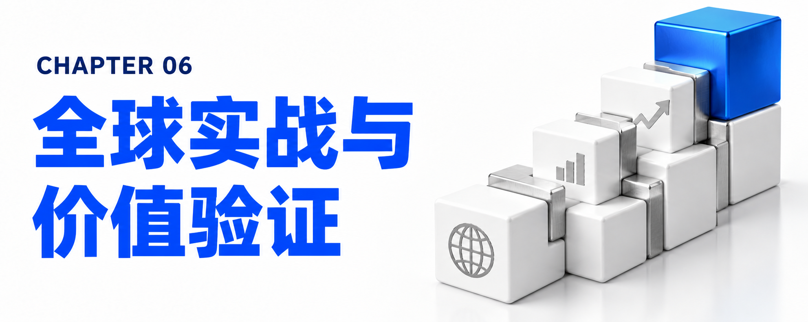

# 第六章：FDU 能解决什么问题？——全球标杆实战案例与“零号客户”的 ROI 铁证

一套交付方法论到底是不是真金白银的破局利器，不能看宣传口号，而要看财务报表上的数字和真实生产环境里的战果。

FDU 之所以能在 2026 年迅速席卷全球企业市场，核心原因在于：IBM 不仅在外部多家行业龙头企业中跑通了规模化生产，更首先将自己作为“零号客户（Client Zero）”，在自家近 30 万人的庞大商业帝国里完成了极限压力测试。

## 6.1 “零号客户（Client Zero）”自证：45 亿美元生产力红利是怎么炼成的？

当 FDU 团队走进客户会议室时，他们推销的不是未经验证的 PPT，而是已经写在 IBM 公开审计财报里的真金白银。

自 2023 年初启动“IBM 作为零号客户（IBM as Client Zero）”全公司转型以来，IBM 将混合云、AI、自动化以及 FDU 所依赖的智能体织网（Agent Fabric）、上下文层与商业外壳率先应用于自身运营：

- 财报级财务成果：根据 IBM 2025 年第四季度及 2026 年第一季度财报披露，原本定下在 2024 年底实现 20 亿美元生产力节省的目标被大幅超越——截至 2025 年底，IBM 已实现高达 45 亿美元的年化运营生产力节省（Annual run-rate savings），并预计在 2026 年底进一步跃升至 55 亿美元！这直接推动 IBM 在 2025 年创造了十余年来最高的 147 亿美元自由现金流，全公司生成式 AI 累计业务订单（Book of business）突破 125 亿美元（其中咨询业务独占 105 亿美元以上）。
- 软件研发域（IBM Bob）：IBM 全员软件开发者已全面用上自研的新一代 AI 软件开发系统 IBM Bob，通过多模型智能编排覆盖从遗留系统现代化到安全加固的全生命周期，全公司超 2 万名研发人员平均生产力飙升了 45%。
- 人力资源域（AskHR）：内部智能体 AskHR 在无需人工干预的情况下，全天候在几分钟内自动解答了全公司 94% 的员工常见咨询，管理者处理员工晋升等流程的速度提升了 75%，仅 2024 年一年就为高价值工作释放了 390 万个小时。
- 客户支持与 IT 运维域：客户支持数字助手独立解决了 70% 的咨询，复杂问题解决时间缩短 26%，客户满意度跃升 25 个百分点，自 2022 年以来累计节省 1.65 亿美元运营成本；IT 现代化则累计节省了约 6 亿美元。
- 网络安全域（ATOM）：在安全运营中心（SOC）中，IBM 部署了由 30 名数字员工组成的自主威胁运营机器 ATOM（Autonomous Threat Operations Machine）。过去面对重大安全告警，一名人类安全专家需要耗时 45 分钟进行取证调查；现在 ATOM 只需 2 分钟即可完成全套深度调查，人类专家只需花 13 分钟进行复核把关——仅上个月一个月，人机团队就高效完成了 70,000 次安全威胁调查，且绝大多数一次性通过人类复核！

## 6.2 全球五大行业标杆实战拆解：从航空、快消到医疗与能源公用事业

在外部客户战场，FDU 及其核心底座平台已经在多个截然不同的传统与新兴行业中解决了长期悬而未决的“落地死结”：

| 客户名称与所属行业 | 面临的核心业务痛点与瓶颈 | FDU / IBM AI 交付方案与核心动作 | 经验证的量化商业成果 (ROI) |
| --- | --- | --- | --- |
| 利雅得航空 (Riyadh Air) 航空运输业 | 传统航司背负长达 50 年的遗留系统补丁包袱，客服、机组与财务数据严重割裂；需在短短三年内从零建成连接全球 100+ 目的地的现代化航司。 | 派驻 FDU 依托 ICA 与 watsonx Orchestrate 担任总编排器，在一张数字白纸上统合 59 个工作流与 60+ 生态伙伴（Apple、Adobe、Microsoft、FLYR），构建員工数字工作台、机组移动礼宾智能体与 EPM 绩效套件。 | 成功发布全球首家“AI 原生航空公司（AI-Native Airline）”，一步跨过 50 年技术债，在未来 12 个月员工规模翻倍的同时实现全链路智能协同。 |
| 普罗维登斯医疗 (Providence) 医疗健康与 HR | 美国最大非营利医疗系统之一（跨 7 个州、51 家医院、11.9 万名医护人员、受 100+ 劳工协议约束）；每年 3.5 万个岗位填补中近一半为内部转岗，但旧流程极其繁琐，医护人员甚至觉得“先辞职再从外部重新应聘”比内部转岗更容易。 | 跨学科团队采用以人为本设计（HCD），不替换任何一套现有核心系统，直接在现有 Oracle Fusion Cloud HCM/Recruiting 之上，基于 watsonx Orchestrate 构建招聘与内部转岗数字员工 RITA。 | 招聘经理行政管理耗时暴降 90%；岗位申请准确率提升 70%；医护人员内部转岗到岗时间平均缩短 12 天；单次转岗成本降低 60%。 |
| 雀巢 (Nestlé) 全球食品饮料巨头 | 业务遍及 186 个国家，核心“订单到现金（Order-to-Cash）”数据集市横跨 44 张大表、PB/TB 级数据；以往基于 CPU 刷新一次需要 15 分钟，每天只能运行寥寥数次，制约全球供应链实时决策。 | FDU 进驻推进 AI 规模化投产；在统一数字骨干网基础上，联合 NVIDIA 将 GPU 加速的 watsonx.data Presto 引擎嵌入核心订单到现金业务流，并利用 Docling + Nemotron 破解非结构化文档提取难题。 | 全球运营数据单次查询刷新时间从 15 分钟骤降至 3 分钟；实现 83% 的成本节省，整体性价比（Price-performance）飙升 30 倍。 |
| 喜力 (Heineken) 全球酿酒与快消巨头 | 旗下拥有 340+ 品牌、业务遍布 190+ 国家，各运营公司（OpCos）数据与流程分散，急需推进 Evergreen 2030 战略，打通财务、供应链与商业的“数字骨干网”。 | 部署 FDU 与 ICA 平台设置 AI 助手与智能体，在 Azure 云上构建整洁的全球 SAP S/4HANA 核心，并将传统 DataOps 全面升级为 AI 驱动的智能运维（AIOps）。 | 系统部署时间缩短 95%（从 1-2 天降至 45 分钟）；硬件/虚拟机开通时间缩短 98%（从 10-15 天降至 5 分钟以内）；落地 54+ 自动化用例，缩减超 500GB 数据足迹。 |
| 印度某大型银行 金融与核心银行现代化 | 需要将成百上千个复杂的遗留数据处理作业（Data processing jobs）迁移到新一代技术平台上，传统人海战术耗时长、成本极高且易出错。 | 采用 FDU 小队模式，由人类专家负责调优输入指令与上下文（使智能体转换准确率从 70% 迭代升至 85%、90%+），由 10-20 个智能体吸收绝大多数重复性代码转换与测试工作。 | 传统模式需 300 人苦干 12-15 个月的浩大工程，FDU 仅用原有团队极小一部分兵力，在不到 9 个月内即高质量完成交付。 |
| 北美能源与公用事业联盟 SAP AI 灯塔委员会 | 面临基础设施老化、清洁能源转型与严格监管；在强监管环境下，单家公用事业公司无法独自承担孤立 AI 试验的高昂风险与验证成本。 | 运用 FDU 方法论联合 Chesapeake Utilities 及全美最大公用事业公司等 6 家北美巨头（覆盖 18 州 5,000 万居民），基于 SAP S/4HANA 展开 24 周“共同定义、共同构建、共同验证”冲刺。 | 开创“构建一次、共同验证、部署多次”的行业共享智能体层模式，在客服账单异常、财务自动应计、电网变压器与智能电表管理三大领域实现每次调用皆可追溯商业价值。 |

## 6.3 前瞻预警：当 FDU 解决了“工程产能瓶颈”后，企业将迎面撞上哪三大新瓶颈？

FDU 的强悍之处不仅在于解决眼前的落地难题，更在于它对企业转型演进规律的深刻预判。Varun Bijlani 提醒所有企业高管：当你成功引入 FDU 模式、AI 红利开始真正落入公司损益表（P&L）时，企业的瓶颈并不会消失，而是会发生转移。

过去，因为工程交付产能（Capacity）太慢，掩盖了企业内部一直存在的另外三个深层问题；一旦 FDU 彻底打通了产能瓶颈，这三个问题就会立刻浮出水面成为新的决胜点：

1. 新瓶颈一：决定“造什么”（Deciding What to Build）
- 当构建软件的速度提升数倍、成本大幅下降后，“造错东西的代价”将远远超过“开发产能的成本”。财务重心将从下游的“工程交付”大幅上移至上游的“投资组合治理（Portfolio Governance）”——在 AI 时代，以更快的速度造出一个错误的系统，是企业最昂贵的自杀方式。这也是为什么 Nathan Limbert 强调，最优秀的 FDU 团队不仅帮客户构建 AI，更由于身处业务一线，能够帮客户避开“AI 沉没成本陷阱（AI Sunk Cost Trap）”，果断叫停那些没有商业价值的项目——有时候，及时叫停工作比把它做完能创造更大的价值。
2. 新瓶颈二：架构完整性（Architectural Integrity）
- 当 AI 在更多团队和合作伙伴之间以更快的速度生成海量代码时，谁来为整个企业的数字资产底座兜底？架构漂移（Architectural Drift）、AI 治理失控、模型静默失效以及监管合规敞口，这些问题不属于交付执行层，而属于企业的技术权威层（Authority）。
3. 新瓶颈三：组织的消化与吸收能力（Organizational Uptake）
- 当 IT 与 FDU 团队能够以“按天、按周”的速度交付智能体系统时，企业内部的业务部门、一线员工和管理制度往往根本跟不上这种变革节奏。向一个消化缓慢的组织输入极速的工程交付，依然无法撬动最终的财务红利。
