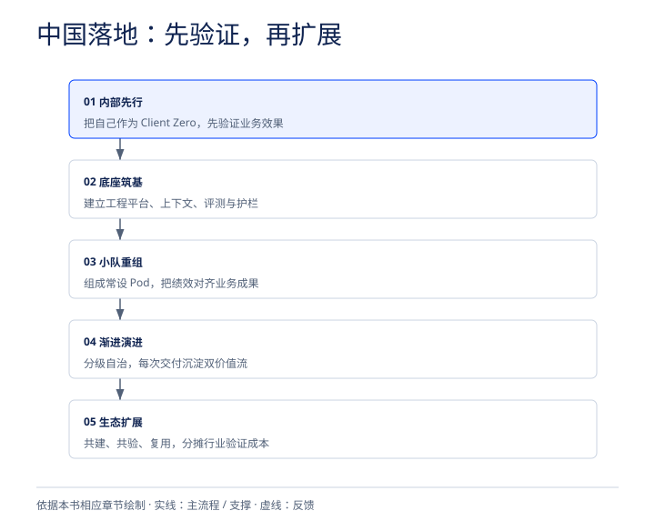

# 第七章：深度探讨——FDU 模式在中国国内落地的前景、水土不服与破局指南

看完了 IBM 在全球掀起的这场从 FDE 到 FDU 的交付革命，所有中国科技从业者、ToB 软件厂商、咨询机构以及甲方 CIO/CTO 最关心的问题必然是：这套“6 人 + 智能体顶 30 人”的 FDU 模式，在中国本土企业级市场到底能不能跑通？前景如何？如果我们要在国内落地 FDU，会撞上哪些特有的“暗礁”，又该如何实操破局？

事实上，IBM 对中国及亚太市场极为重视——2026 年 5 月 14 日全球首发 FDU 时便明确将亚太列为重点规模化部署区域；6 月 3 日，IBM 咨询总裁 Mohamad Ali 署名在北京发布官方中文版宣言《用一种全新的方式，让 AI 真正落地现实世界》；8 月至 9 月，IBM 又先后在中国香港及中国大陆市场同步推进与 OpenAI 的企业级合作及 SAP 公用事业 AI 灯塔委员会落地。与此同时，国内技术社区（如 FDE-Wiki 等）也已开始围绕 FDE/FDU 的团队组建与组织设计展开深度探讨。

结合中国本土 ToB 市场的真实生态，我们可以从历史机遇、四大本土化阻力、五步实操破局手册三个维度，给出最接地气的深度研判。

## 7.1 为什么说中国企业级 AI 市场正处于呼唤 FDU 的“前夜”？

当前，中国企业级 AI 市场正在经历与欧美市场高度相似、甚至更为剧烈的阵痛期，这为 FDU 模式的本土化生根提供了三大核心驱动力：

1. 逃离“PoC 坟场”的迫切刚需：过去两年，国内从央国企、商业银行、大型车企到头部制造企业，几乎家家都立项了数十个大模型试点（PoC）——搭了知识库问答、做了会议纪要助手、搞了公文写作插件。但到了 2026 年，甲方的财务部门和一把手开始严查 ROI：“花了上千万买算力、做微调，到底帮业务部门省了多少成本？缩短了多少交付周期？”单纯卖大模型 API、卖算力一体机或做浅层聊天套壳的厂商已陷入惨烈价格战，市场极度渴求能深入核心业务系统（ERP、MES、HIS、核心银行系统）拿出确定性业务结果的 FDU 级团队。
2. 传统“人头外包（ITO）”商业模式的全面崩塌：中国软件与技术服务行业长期存在庞大的“人力外包”生态——靠派驻成百上千名初、中级程序员按“人月”计费。随着编码智能体（Coding Agents）的普及，甲方研发领导自己都清楚：原本需要 20 个初级外包写三个月的代码，现在 2 个资深工程师带着智能体两周就能干完。继续按传统人海战术卖“人头”，在甲方的降本增效大刀下已毫无生存空间，向“高人才密度 + 数字员工”的 FDU 模式转型是本土 IT 服务商唯一的活路。
3. “信创国产化替代 + 遗留系统 AI 现代化”的双重历史交汇：中国大型政企、金融与能源客户不仅面临老旧系统（如早期定制的 ERP、传统数据库、复杂中间件）的技术债，还叠加了“信创（信息技术应用创新）全栈国产化迁移”的硬性任务。这类工程涉及海量的存量代码转换、异构数据迁移与自动化测试——正如前文印度大型银行将 300 人 15 个月工程压缩至 9 个月以内的案例一样，这恰恰是 FDU + 智能体挽具（Harness）发挥“技术套利”威力的绝佳主战场。

## 7.2 警钟长鸣：FDU 在国内落地必闯的“四大水土不服关”

尽管前景广阔，但如果哪家国内厂商或企业生搬硬套海外的 FDU 模板，大概率会在三个月内碰得头破血流。因为中国本土 ToB 环境存在着四个极具杀伤力的特殊国情：

**FDU 模式在中国本土落地的“四大现实拦路虎”**

| 项目 | 说明 |
| --- | --- |
| 拦路虎 1：招投标与审计刚性约束 | 国企/大厂采购体系认“人天/工作量审计”，难直接签纯结果对赌合同 |
| 拦路虎 2：驻场文化的异化风险 | 精英 FDU 极易被甲方业务部门当成“随叫随改需求的免费驻场苦力” |
| 拦路虎 3：非标二开与数据荒漠 | 大量企业无标准 SOP 文档，业务靠口耳相传，定制化“二开”极重 |
| 拦路虎 4：全栈复合型人才断层 | 既懂垂直行业深水区政企逻辑、又懂智能体架构的 FDA/FDE 极度稀缺 |

### 第一关：采购招投标与审计体制的刚性约束

在欧美市场，正如 IBM 咨询高级副总裁 Mohamad Ali 在访谈中坦言，尽管 IBM 极力推行固定总价（Fixed-price）与按结果付费（Outcome-based Pricing），但仍有不少企业客户“还不知道如何消费按结果付费的合同，因为他们的采购部门根本不是按那套逻辑建立的”。而在中国，央国企、金融机构和政府部门受限于严格的采购法规、预算管理制度与事后审计要求，招标文件往往必须明确列出“投入多少名高级/中级/初级工程师、驻场多少人月、单人天定额标准是多少”。

这种传统的“工时与材料（Time and Materials, T&M）”、“人天费率卡（Rate Cards）”或“全职等效人力（FTE）”商业原语，本质上是为过去三十年“人力即规模因子”的时代校准的。正如 IBM 混合云与数据全球管理合伙人 Javier Olaizola 指出的那样：“如果你按小时定价，所有人的动机基本上都是最大化工作小时数，而不是最大化业务成果。” IBM 全球管理合伙人 Debbie C Vavangas 也在研究中一针见血地指出：在 FTE 和工时利用率体系下，效率不仅得不到奖励，反而受到变相惩罚——服务商为了保住营收会最大化人力投入，而甲方的采购机制恰好强化了这种低效均衡。

如果国内科技服务商直接拿着“6 人 FDU 替代 30 人团队”的方案去投标，在传统“按人头核价”的审计体系下，预算可能会被直接砍掉五分之四，导致服务商“用 AI 帮甲方提效，自己却亏本出局”的荒诞结果。

### 【本土化破局方案：用“组合式商业包装器（Commercial Wrappers）”过审】

参照 Varun Bijlani 与 Mohamad Ali 披露的 IBM 实战商业设计，国内团队切忌一步到位强推“纯结果对赌”，而应采用“四层组合式商业包装器”来适配国内招投标与审计体系：

1. 第一层：从“人月外包”切换为“固定总价合同（Fixed-Price Projects）”。Mohamad Ali 指出，由于 IBM 对“人类+数字员工”的交付能力有极高把握，固定总价已成为首选模式。在国内招投标中，“固定总价+里程碑验收”完全符合政府与国企采购规范，服务商无需虚报人头，而是以端到端系统交付物立项。
2. 第二层：按“用户故事/功能点（Per Story）”进行细粒度计费。将庞大的软件工程拆解为可量化、可审计的业务功能点或用户故事（User Story）进行颗粒度定价，既满足国内造价审计对“工作量核定”的合规要求，又将计费锚点从“消耗了多少工时”转移到“交付了多少特性”。
3. 第三层：引入“吞吐量服务级别目标（Throughput SLO）”与持续运营协议。在应用维护（AMS）或业务流程运营中，将合同与系统吞吐量、事件解决速度、复发故障率下降等可量化的 SLO 挂钩。
4. 第四层：叠加“可复用资产与平台订阅（IP Subscription / Asset Licensing）”。通过类似 IBM Enterprise Advantage 的资产型咨询服务模式，将随项目交付沉淀下来的行业智能体、上下文库、测试套件与平台底座打包为软件资产许可给客户复用。正如 Varun Bijlani 所强调的：“没有任何一种包装器能单独奏效，组合（Composition）才是破局关键——唯有如此，当底层生产力提升、单点价格下降时，价值捕获才不会流失。”

### 第二关：驻场文化的异化风险（如何防止精英 FDU 沦为“高级驻场苦力”？）

在中国 ToB 软件交付现场，有一种令所有技术团队闻风丧胆的现象——“驻场异化”。无论乙方派过去的是多么顶级的架构师或咨询顾问，一旦进入甲方现场，极易被甲方业务部门当成“随叫随到的免费改需求工具人”：今天临时改个报表字段，明天帮业务员导个数据，后天开一整天跨部门扯皮会。

如果 FDU 小队陷入这种泥潭，所谓的“6 人 + 智能体顶 30 人”会在瞬间崩溃。因为 FDU 的核心算力引擎是“两端的人类高阶判断 + 中间的数字员工自动执行”；一旦两端的人类专家被高频、琐碎、毫无上下文规范的临时口头需求淹没，整个智能体流水线就会彻底瘫痪。

### 【本土化破局方案：用“三大铁律”重构甲乙双方现场协作边界】

结合 IBM FDU 的组织架构与激进应用开发（Radical Application Development, RAD）方法论，国内团队必须在入场第一天就立下三条铁律：

- 铁律一：设立高职级的“客户成果负责人（Client Outcome Lead）”，直接对齐甲方高管 QBR。在 FDU 中，不能只有埋头写代码的工程师。必须配备一名由资深行业领袖或前甲方高管担任的 Client Outcome Lead，端到端对业务结果（如结账周期压缩、获客成本降低、吞吐量提升、合规风险闭环）负责，并在甲方的季度业务评审（QBR）中直接向决策层交账。同时，业务领域专家（Business Domain Specialist）的职责是与甲方流程负责人协作并“挑战（Challenge）”其原有流程，重新思考业务目标，而非被动接单。
- 铁律二：用“规范文件夹（Spec Folder）”取代口头传话与工单扯皮。引入 Sutapa Sen 阐述的 RAD 规范驱动开发模式——拒绝任何口头临时改需求，将“规范文件夹（包含 research.md、quickstart.md、spec.md、plan.md、tasks.md 与实时追踪进度的 workflow-state.md）”作为人类与智能体之间唯一的“单一事实来源（Source of Truth）”。所有的需求歧义必须在编写 spec.md 阶段解决，下午的时间用于验证智能体产出的结果，而不是在无休止的同步会议中追问需求。
- 铁律三：赋予 FDU“叫停沉没成本项目”的预警权。正如 IBM 咨询 AWS 实践全球 CTO Nathan Limbert 所言，企业面临的最大风险之一是“AI 沉没成本谬误（AI Sunk Cost Fallacy）”——明知项目不产生价值，却因已投入巨资而硬着头皮继续。FDU 嵌入客户现场获取的是实时运营反馈而非季度汇报，一旦发现某个方向的优化没有业务价值，及时叫停工作（Stopping work）往往比盲目做完能创造更大的价值。

### 第三关：非标二开与“数据/流程荒漠”（没有标准 SOP、老系统改得面目全非怎么办？）

许多海外标杆企业（例如雀巢 Nestlé）之所以能在短时间内跑通 GPU 加速的 watsonx.data 订单到现金（Order-to-Cash）概念验证，将跨 186 个国家、44 张数据表的查询刷新时间从 15 分钟压缩到 3 分钟、成本降低 83%，一个关键前提是雀巢早已具备强大的“数字主干（Digital Backbone）”——拥有全球统一的数据模型、整合的数据底座与单一事实来源。

然而反观国内大量传统制造、能源、医药及政企客户，内部往往面临两大顽疾：

1. 流程黑盒化与文档缺失：根本没有成体系的最新版标准作业程序（SOP），大量核心业务逻辑保存在老员工的脑子里、微信聊天记录里、散乱的 Word/PDF 甚至口耳相传的“潜规则”中；正如 IBM 咨询管理合伙人 Michael Healy 所指出的，许多企业受困于技术债与人工交接，连自身现有工作流到底是怎么运转的都搞不清楚。
2. 重度“非标二开”与架构腐化：核心 ERP（如早期 SAP 或国产 ERP）经过十几年外包团队层层打补丁，定制化代码（Custom Code）堆积如山，远离了“洁净核心（Clean Core）”与标准化 API 要求。如果直接把 AI 智能体塞进这样低效、混乱的流程中，正如 IBM 杰出工程师 Dharma Atluri 警告的那样，只会“把低效自动化（Automate the inefficiency）”，而不是消除低效。

### 【本土化破局方案：“流程吞噬者 + 非结构化清洗 + 非破坏性编排”三板斧】

针对国内企业的“流程荒漠”与“重度二开”，FDU 提供了三套经过验证的工程化解法：

- 第一板斧：用“渠道伙伴 + Procedure Eater（流程吞噬者）”周末全自动测绘流程。Mohamad Ali 透露，当客户缺乏现成流程文档时，IBM 一方面会利用渠道合作伙伴入场协助梳理，另一方面直接动用名为 Procedure Eater 的工作流分析工具与 Process Studio。在近期一个客户项目中，Process Studio 底层资产一口气分析了 1,400 份作业程序文档，挖掘出 1,000 多个改进机会，并将工作流拆解为可独立验证的“原子级步骤（Atomic Processes）”，精准划分哪些步骤该用确定性代码（Deterministic Code）、哪些该委派给 AI 智能体、哪些需要人类在环（Human-in-the-loop），预计在 18 个月内帮客户削减超过 25% 的运营成本。
- 第二板斧：用 Docling + Context Studio 攻克多模态非结构化“暗数据”。针对散落在企业各处的 PDF、扫描件、老旧知识库与专家经验，利用 IBM Docling 等工具将其标准化转换为具有源级可追溯性（Source-level traceability）的 AI 就绪格式，再通过 Context Studio 将企业特有的行业黑话、业务规则与系统关系编码为机器可读的持久化知识图谱与记忆底座。
- 第三板斧：借鉴 Providence 医疗案例，采用“不替换任何一套核心系统”的顶层编排策略。面对拥有 11.9 万名医护人员、受 100 多份复杂劳工协议约束的美国大型医疗系统 Providence，IBM 咨询并没有推翻其原有的 Oracle HCM 和招聘系统，也没有强推漫长的底层重构，而是基于 IBM watsonx Orchestrate 打造了数字员工 RITA，在现有系统之上建立统一的智能体控制平面（Control Plane）来跨系统编排审批与数据流。仅用约 8 个月时间，就在“不替换任何一个核心系统（Without Replacing a Single System）”的前提下，将招聘经理的行政管理时间削减了 90%、内部调岗速度加快 12 天、调岗成本降低 60%、流程准确率提升高达 70%。这种“顶层智能编排 + 渐进式 Clean Core 治理”的打法，正是国内重度二开企业最现实的破局路径。

### 第四关：全栈复合型人才断层与“初级程序员培养悖论”

FDU 模式之所以能实现“3-8 人干 30 人的活”，核心在于全员极高的人才密度。Gartner 在 2026 年 6 月发布的报告中预测：到 2029 年，80% 的企业将主动把“人才密度（Talent Density）”置于“人才规模（Talent Mass）”之上，而这一比例在 2025 年仅为 5%。

但这给国内技术团队带来了双重挑战：

1. “AI 通才（AI Versatilists）”极度稀缺：FDU 需要的不是只会写 CRUD 代码的单一工种，而是既懂垂直行业业务痛点、又精通提示词工程、多智能体编排（Multi-agent Orchestration）、上下文工程（Context Engineering）与企业级系统集成的复合型老兵。
2. 传统“师徒金字塔”培养链条断裂：过去咨询公司和软件大厂靠招收大量应届毕业生干写代码、写测试用例、查资料、改文档等“脏活累活”，在干活过程中慢慢熬成资深专家。现在这些基础工作全被 AI 智能体接管了，如果不招初级员工，五年后哪来的资深专家？如果招了初级员工，他们进组干什么？

### 【本土化破局方案：重构“判断力层（Judgment Layer）”的浸入式学徒制】

Javier Olaizola 对此给出了极具前瞻性的解答：当智能体接管常规生产工作后，人类的核心价值已经全面转移到了“判断力层（The Judgment Layer）”——就像记者在 AI 时代的核心价值不再是码字生产内容，而是“确保提供正确的视角、核实准确性与合规性”一样，工程师和顾问必须判断智能体生成的代码是否符合银行安全规范、是否调用了违规数据、是否契合整体架构。
为此，国内企业和科技厂商必须借鉴 IBM 的“双轨制人才供应链”：

- 针对初级人才（Applied AI Associate Program 浸入式学徒制）：不再让应届生在入职前几年做机械的填表和基础编码，而是从第一天起就把他们直接编入前线 FDU 小组（例如 Mohamad Ali 提到的“1 名资深架构师 + 2 名初级人员”的 3 人微型 FDU 配置）。让新人在资深专家身边，直接操作 Process Studio、运行智能体代码构建器、参与问题定义与输出质量评估——将“培养判断力”作为新人训练的直接目的，而不是顺带的副产品。
- 针对高端成果负责人（独立继任通道）：从具有甲方高管背景的行业老兵或资深合伙人中专项选拔 Client Outcome Lead，赋予其极高权重的业务结果导向薪酬，让真正懂行的人为最终商业指标兜底。

## 7.3 保姆级实操手册：国内企业与技术团队落地 FDU 的“五步破局路线图”

*国内落地五步路径。依据本章原文绘制。*

如果你是一家国内 ToB 软件厂商、云与 AI 服务商、咨询机构的负责人，或者是一家正在推进 AI 转型的甲方 CIO/CTO，明天开始想在组织内部组建并跑通 FDU，应该怎么做？基于 IBM 内部数十亿美元验证的实战经验，我们为你提炼出一套可直接抄作业的“五步破局路线图”：

**国内企业落地 FDU 模式的“五步实操破局路线图”**

| 项目 | 说明 |
| --- | --- |
| 【Step 1】内部先行 (Client Zero) | 先把自己当成零号客户，用两周冲刺跑通内部提效飞轮 |
| 【Step 2】底座筑基 (Uber Harness) | 拒绝裸发账号，搭建“三大工作室+四支柱挽具”平台底座 |
| 【Step 3】小队重组 (Pod & Comp) | 按“两端是人、中间是Agent”混编3-8人小队并改革绩效 |
| 【Step 4】渐进演进 (5-Level & 2V) | 沿五级自主模型切入，每次交付沉淀“双价值流”资产 |
| 【Step 5】生态裂变 (Lighthouse) | 组建行业灯塔委员会“共建共享”，借高人效下沉中端市场 |

### 第一步：把自己当成“零号客户（Client Zero）”，先在内部跑通生产力飞轮

不要在自己还在用传统瀑布流和人海战术写代码的时候，去跟客户兜售 AI 转型。IBM 之所以能底气十足地向全球推广 FDU，是因为早在 2023 年初，CEO Arvind Krishna 就发起了“IBM 作为零号客户（Client Zero）”的全公司自我革命：

1. 确立三大铁律：第一，消除运营复杂性（遵循彼得·德鲁克名言：“没有什么比高效地做一件本不该做的事更无效率的了”，先砍掉冗余流程）；第二，基于混合云与统一可信数据底座简化端到端工作流；第三，全面自动化手动任务并将 AI 嵌入每个角落。
2. 全员武装自研工程系统：在 IBM 内部，超过 20,000 名乃至全部研发人员全面使用新一代 AI 软件开发系统 IBM Bob（Project Bob），通过智能编排 Anthropic Claude、Mistral、IBM Granite 小模型及定制模型，在全软件生命周期实现平均 45% 的生产力跃升。同时，17.8 万名员工参与内部 watsonx 挑战赛，将优秀的岗位智能体沉淀到全公司共享技能库中。
3. 形成财务自造血飞轮：这套打法让 IBM 在 AskHR 上实现了 94% 常见员工问询无人工秒级解答、晋升等管理操作提速 75%，客服数字助手解决 70% 问询，并在 2025 年底提前实现了 45 亿美元的年化生产力节省（预计 2026 年底达到 55 亿美元）。更重要的是，IBM 将内部省出来的利润重新投资到平台资产研发与员工技能重塑上，形成了“内部验证 → 提炼资产 → 赋能 FDU 外部交付 → 反哺平台”的复利飞轮。

### 第二步：搭建“超级挽具（Uber Harness）”平台底座，绝不裸发 AI 账号

Mohamad Ali 在复盘行业教训时一针见血地指出：三年前几乎所有竞争对手都在干同一件事——花大价钱买上十万个 Microsoft Copilot 或 OpenAI 账号发给员工，说“拿去提高生产力吧”，结果根本不起作用（It just didn't work）。
国内企业落地 FDU，必须在底层大模型之上构建自己的“超级挽具（Uber Harness）”与工程平面（Engineering Plane）：

- 对数字员工进行严格的产品化筛选与打包（Packs）：IBM 最初发动员工构建了多达 50,000 个数字员工（凡是调用 LLM 的非确定性模块均视为数字员工），但发现数量太多反而不好用；随后专门从软件部门引入产品管理团队进行分流与 QA 质检，精选出 6,000 个生产级数字员工，并按业务场景封装成 155 个标准资产包（Packs）。例如做一个银行前端项目，直接调取包含 20-30 个数字员工的资产包，配合 10 名人类专家在虚拟聊天室里协同生成用户故事、编写与测试代码。
- 实施模型路由（Model Router）严控 Token 成本：FDU 规模化运行会产生海量调用（IBM Consulting Advantage 每月消耗约 5,000 亿 Tokens，同时实时运行着 600 个大型人机协同项目）。通过模型路由器根据任务复杂度动态匹配最经济的模型（如结合开源小模型 Granite 与前沿大模型 GPT-5.6 / Claude），IBM 将平均推理成本精准控制在 每百万 Token 2.58 美元。
- 采用“技能集中托管、用完即焚”架构保护核心 IP：国内服务商最怕自己辛苦沉淀的提示词、工作流和行业 Know-how 在驻场时被轻易拷走。IBM 的做法是：绝不在第三方 AI 工具本地原生构建和留存技能（Skills），而是将所有核心技能集中存储在自家的平台底座（ICA）中；当 FDU 在客户现场调用某款工具时，技能包临时下载注入，执行完毕后立即从本地消失。这种中央 IP 保护机制，才是咨询与技术服务商别人抄不走的真正护城河。

### 第三步：按“两端是人、中间是 Agent”混编 3~8 人精锐 Pod，彻底改革绩效考核

抛弃过去动辄几十人的部门墙编组，以 3 人（小型单元）至 6~8 人（标准/大型单元） 的规模组建常设作战单元（Standing Operational Pod）：

- 保持 Pod 番号与记忆的持久性：项目结束时，FDU 小组不就地解散，而是保持核心团队编制跨项目流转，使领域知识与工程经验在同一个团队手中持续产生复利。
- 彻底废除“工时利用率”紧箍咒：立即修改内部 PMO 与 HR 的考核指标——不再考核顾问和工程师“填满了多少工时表”，而是考核项目利润率（Profitability）、客户业务成果达成度（QBR 满意度）以及向公司中央资产库贡献了多少可复用的模式、评测套件与智能体配置（IP Generation）。

### 第四步：遵循“五级自主演进阶梯”与“双价值流交付”，用迭代调优取代人海返工

在客户现场切入具体业务（如核心银行数据迁移、SAP 运维、财务或 HR 改造）时，严禁盲目承诺“一步到位实现 100% 全自动无人化”：

1. 对号入座“五级自主演进模型”：按照 Dharma Atluri 提出的演进路径——从 L1 人工辅助（AI Assists） → L2 嵌入工作流（Embedded in Workflows） → L3 委派特定任务（Delegate Specific Activities，人处理异常） → L4 多智能体跨步协同（Multi-agent Coordination） → L5 自主运营与按异常管理（Autonomous Operations / Manage-by-exception），根据客户每个具体流程的数据就绪度与风险承受力分级推进。
2. 用“调优输入（Working on the inputs）”取代“人工逐行改错”：借鉴 Javier Olaizola 分享的印度大型银行数据现代化迁移案例（将原本需要 300 人干 12~15 个月的数千个数据处理作业迁移，用极小规模团队在 9 个月内拿下）——当智能体第一轮转换遗留代码的准确率只有 70% 时，千万不要派一堆程序员去手动修改那 30% 的报错代码，而是让 FDU 专家研究错误模式、修改喂给系统的指令与上下文（Context），重跑验证使其准确率跃升至 85%、90% 以上，再将这套跑通的方法批量复制到成百上千个同类作业中。
3. 坚持“双价值流（Two Value Streams）”交付：每次项目结束，不仅要向客户交付第一价值流（跑通的系统、自动化的流程、合同约定的业务指标），还必须交付第二价值流（沉淀下来的企业专属上下文资产包、证明 AI 有效的自动化测试套件、智能体配置文件与演进方法论），通过类似 IBM Enterprise Advantage 的服务转化为客户内部可持续自主演进的 AI 平台。

### 第五步：构建“行业灯塔联盟”分摊验证成本，并借高人效杠杆下沉中端市场（Midmarket）

针对国内强监管行业（如电力能源、金融、央国企）“不敢第一个吃螃蟹、单家企业试错成本高”的痛点，以及传统大厂“做不起中小型客户定制项目”的局限，FDU 提供了两把商业裂变利器：

- 打法 A：发起“构建一次、共同验证、多次部署（Build Once, Validate Together, Deploy Many）”的行业灯塔委员会。参考 IBM 在 2026 年 9 月联合 Chesapeake Utilities 等北美六大公用事业巨头（覆盖美 18 个州逾 5,000 万居民）成立的 IBM AI Lighthouse Council（AI 灯塔委员会）。围绕行业共性底座（如 SAP S/4HANA），通过 24 周联合构建周期、三阶段方法论（共同定义 Co-Define、共同构建 Co-Build、共同验证 Co-Validate）和三道正式反馈关口，集中打造客户运营（账单异常、催收优化）、财务供应链（自主应计、跨源对账）和现场资产管理（变压器管理、智能电表分析）等生产级智能体。每家成员企业只需派出一名高管发起人和业务专家参与设计验证，就能分摊高昂的合规验证成本，直接获得适配自身环境的智能体部署、参考架构和每一次调用均可追溯至具体业务价值的商业论证模板。
- 打法 B：利用“技术套利（Technology Arbitrage）”击败低价外包，并下沉开拓中型企业市场（Midmarket）。Mohamad Ali 透露了一个极具震撼力的实战案例：在近期欧洲一家制药企业的竞标中，素来以“高端高价”著称的 IBM 咨询正面迎战多家主打低成本离岸外包（Low-cost offshore providers）的竞争对手；结果凭借“人类+数字员工”的 FDU 组合，IBM 竟然成为了全场报价最低的供应商（Low-cost provider），同时保持了最高质量。更重要的是，过去大型咨询公司和头部软件厂因为需要派驻庞大团队，根本服务不起中型企业（Midmarket）；如今只需 3~6 人的小型 FDU 就能极速交付，让头部技术团队得以大举切入广阔的腰部与中型企业市场。

## 7.4 角色对号入座：给国内甲方 CIO、乙方服务商与一线工程师的行动清单

为了让你能将本文的方法论立即转化为明日的行动，我们针对国内生态中的三类核心角色，整理了这份《FDU 时代生存与跃迁清单》：

| 核心角色 | 立即停止做的事（Stop Doing） | 立即开始做的事（Start Doing） | 核心衡量指标（New Metrics） |
| --- | --- | --- | --- |
| 甲方企业 CEO / CIO / 数字化负责人 | 1. 停止立项脱离核心业务流、无 ROI 闭环的孤立聊天机器人试点 2. 停止单纯按“派驻人头数/工时”评估和采购外部技术服务 3. 停止在未梳理混乱流程前盲目把 Agent 塞进旧系统“将低效自动化” | 1. 用“自主运营六问”体检自身系统（Clean Core、数据、流程、治理、组织、价值度量） 2. 要求服务商采用 FDU 模式，实行固定总价或按业务结果/资产复用混合签约 3. 要求每次项目必须留下“业务成果 + 可复用上下文与测试资产包”双价值流 | • 投资回报率（AI 红利是否真正进入 P&L 损益表） • 首次价值实现时间（Time to first value） • 端到端周期压缩率与运营成本降幅（如 50%~60% 成本削减） |
| 乙方咨询机构 / ToB 软件与 IT 服务商 | 1. 停止靠堆砌初级程序员打“离岸/驻场人海消耗战（Labor Arbitrage）” 2. 停止只给员工买 AI 账号却不建设统一工程平台与护栏底座 3. 停止用“工时利用率（Utilization）”惩罚那些用 AI 大幅缩短工期的优秀团队 | 1. 立即启动 Client Zero 内部改造，把行业经验封装为生产级数字员工与资产包（Packs） 2. 组建包含成果负责人、领域专家、FDA、FDE 的 3~8 人常设 Pod 3. 建立技能中央托管机制保护 IP，并用高人效优势下沉收割中型客户市场 | • 团队利润率与交付毛利（Delivery Margin） • 沉淀至中央库的可复用 IP 与资产包数量 • 由智能体自动化完成的工作占比（% of work automated by agents） |
| 一线架构师 / 研发工程师（FDE 候选人） | 1. 停止把精力消耗在手写样板代码、手动维护测试用例与反复开会对齐模糊需求上 2. 停止当智能体报错时用人工去逐行硬改生成结果 3. 停止守着单一技术栈拒绝理解行业业务流程 | 1. 转向规范驱动开发（RAD），精通编写机器可读的 spec.md 与企业上下文工程 2. 掌握多智能体编排、提示词工程与“通过调优输入来批量修正智能体输出”的能力 3. 向“判断力层（Judgment Layer）”跃迁，磨练架构把控、安全合规审查与业务转化能力 | • 部署前置时间（Lead time to deploy）与部署频率 • 逃逸缺陷率（Escaped defects）与安全合规审计得分 • 单人撬动数字员工集群的吞吐量乘数（如 6 人撬动 30 人产出） |
