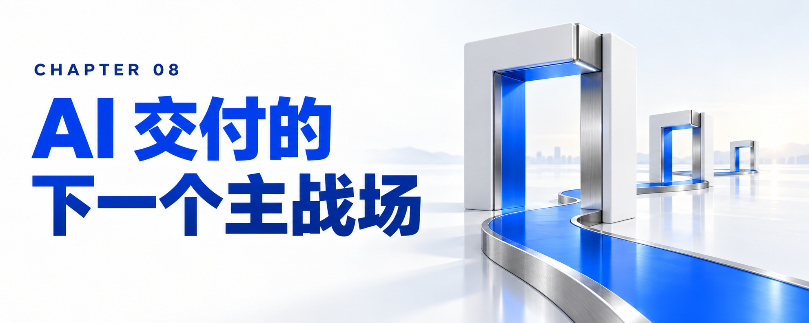

# 第八章：终章——当容量瓶颈被 FDU 攻克，AI 交付的下一个主战场在哪里？

写到这里，我们已经完整拆解了从 FDE（前线部署工程师）到 FDU（前线部署单元）的整场范式革命。

回望过去三十年，企业软件与技术服务的底层逻辑从未改变：人力是唯一的扩展因子（Labor was the scaling factor）——想要更多产出，就得增加更多的人；想要降低成本，就得搞“人力套利（Labor Arbitrage）”，把代码和流程外包给人力更便宜的地方。

而今天，游戏规则被彻底改写了。正如 Mohamad Ali 所言，我们正在进入“技术套利（Technology Arbitrage）”的新纪元。FDE 的兴起撕开了旧世界的第一道裂缝，它向全行业发出了一个明确信号：企业不再为锁在抽屉里的 PPT 战略买单，战略思考与工程执行必须合二为一。但真正终结旧时代、开启新纪元的，不是某个单枪匹马的超级英雄头衔，而是 FDU（前线部署单元） 这套将“两端的高密度人类专家 + 中间的专业智能体数字员工集群 + 底层的企业级工程与治理平台（ICA / Harness / Orchestrate） + 锚定业务成果的商业契约”融为一体的全新运营系统。

## 8.1 跨越容量瓶颈之后：企业即将撞上的“下一代三大瓶颈”

然而，故事到这里并没有结束。作为行业手册，我们必须把目光再往前推演一步：当一家企业成功引入了 FDU 模式，用 6 人的全栈小队加智能体跑出了 30 人的吞吐量，当软件开发和系统改造的“工程容量瓶颈（Capacity Bottleneck）”被彻底攻克、AI 红利开始真正进入企业损益表（P&L）之后，接下来会发生什么？

IBM 全球管理合伙人 Varun Bijlani 给出了一个极其冷峻且深刻的预判：当容量不再是瓶颈时，原本被“研发产能不足”所掩盖的另外三大深层瓶颈，将瞬间暴露在所有 CEO 和 CIO 面前：

1. 第一大新瓶颈：决定构建什么（Deciding what to build —— 投资组合治理的权重剧增）
   在旧时代，最昂贵的成本是“研发产能不够，想做的东西做不出来”；而在 FDU 时代，构建软件的速度被成倍放大，“以更快的速度构建出错误的东西，成了企业最昂贵的错误（Building the wrong thing faster is now the most expensive mistake）”。财务与管理的重心将不可避免地从下游的“交付执行”向上游的“投资组合治理（Portfolio Governance）”与业务价值发现转移。
2. 第二大新瓶颈：架构完整性（Architectural integrity —— 数字资产的全局权威管控）
   当成百上千个智能体跨越不同的团队和合作伙伴，以比以往快十倍的速度疯狂生成代码、修改接口时，谁来为企业整体的数字资产（Digital Estate）兜底？ 架构漂移（Architectural drift）、AI 治理失控、模型静默失效、监管合规敞口——这些问题绝不是靠单点交付速度能解决的，它们属于企业级的架构权威（Authority）与控制平面（Control Plane）。
3. 第三大新瓶颈：组织吸收能力（Organizational uptake —— 业务侧消化变革的极限速度）
   IBM 商业价值研究院（IBV）《2026 CEO 研究》揭示了一个发人深省的数据：高达 83% 的 CEO 坦言，AI 能否成功，更多取决于“人能多大程度接受它”，而非技术本身；然而目前在日常工作中真正熟练使用 AI 的员工比例仅为 25%。当 IT 与 FDU 团队能在几天之内交付一套全新的智能体业务系统，但企业剩余的业务部门却无法以同样的速度消化流程变革、调整组织分工时，“把更快的交付塞进一个缓慢适应的组织里，依然无法推动 AI 红利落地”。

## 8.2 结语：AI 的下半场，属于构建“最佳交付系统”的人

从孤立的生成式 AI 聊天玩具，到单兵突进的 FDE，再到成建制、可复利、对商业结果负责的 FDU 作战单元，企业级 AI 终于走过了喧嚣的概念炒作期，踏入了硬核工程与运营模式重构的深水区。

正如 Debbie C Vavangas 在阐述“激进应用开发（RAD）”时写下的那段结语——这段话值得每一位技术管理者与从业者贴在案头：

“AI 不会自动创造企业价值，它只是创造了产生价值的条件。这种价值最终能否兑现，取决于围绕它所建立的系统、运营模式、商业结构与人类能力。最终解锁 AI 红利（AI Dividend）的，绝不会是那些仅仅拥有最好模型的企业，而是那些围绕模型构建出最佳系统的企业。”

FDE 已死，死去的是那个试图靠一两个天才程序员单骑救主、修补工业时代旧流水线的浪漫幻想；
FDU 当立，立起的是人类高阶判断力与数字员工规模化执行力深度咬合、战略与工程彻底合一、每一次运行都在累积复利的 AI 原生交付新纪元。
